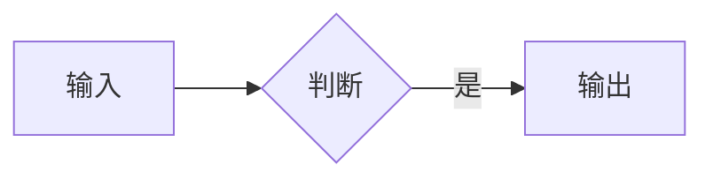

# MCSOG-Docs

中文 | [English](./README_EN.md)

---

## 中文

MCSOG 开服教程站的**公开文档仓库**，用于接收社区修订。

*线上站点每10分钟拉取一次仓库

线上站点：<https://mcsog.ndpreforged.com>

### 仓库结构

```
MCSOG-Docs/
├── README.md              本文件
├── README_EN.md           英文说明
├── docslist.json            教程导航 + 文档索引（仅教程）
└── docs/
    ├── zh/                简体中文（内容源文）
    │   ├── tutorials/     开服教程正文
    │   │   ├── java/      Java 版开服
    │   │   ├── bedrock/   基岩版开服
    │   │   ├── ops/       运维与安全
    │   │   └── faq/       常见问题
    │   ├── wiki/          版本百科（版本时间线、核心对比、指令等）
    │   └── help/          帮助与规范
    ├── en/                英文（与 zh 一一对应）
    ├── zh-TW/             繁體中文
    ├── ja-JP/             日本語
    ├── ru-RU/             Русский
    ├── ar/                العربية
    └── vi/                Tiếng Việt
```

除 `zh` 外，其余语言目录均采用与 `zh` 相同的 `tutorials/`、`wiki/`、`help/` 结构。

### docslist.json 结构

`docslist.json` 只管理开服教程：顶层只有 `nav` 和 `docs`，不再使用旧的 `type → category → language` 结构。

- `nav`：与站点侧栏一致的教程导航项（教程总览、Java 版开服、基岩版开服、运维与安全、常见问题）
- `docs`：教程文档索引，分类固定为 `java`、`be`、`ops`、`faq`（`be` 对应磁盘上的 `bedrock` 目录）

```json
{
  "nav": [
    {
      "key": "tutorials",
      "icon": "book-open",
      "path": "/tutorials",
      "label": { "zh": "教程总览", "en": "Overview" },
      "sub": { "zh": "OVERVIEW", "en": "OVERVIEW" }
    }
  ],
  "docs": {
    "java": {
      "zh": [
        {
          "path": "/zh/tutorials/java/example",
          "title": "示例教程",
          "slug": "example",
          "cat": "java",
          "updated": "2026-11-03",
          "level": 1,
          "minute": 10,
          "order": 1
        }
      ]
    }
  }
}
```

每个文档条目必须包含 `path`、`slug`、`title`、`cat`、`updated`、`level`、`minute`、`order`；可选 `mc`、`tags`、`draft` 等字段。`order` 小的条目排在前面。

新增、删除或重命名教程时，必须同步修改 `docslist.json`。网站会读取该文件；`help`、`wiki`、`news` 由文件系统扫描加载，不写入此文件。旧的完整 `docslist.json` 格式已不再支持。

站点每 10 分钟从本仓库同步文档和 `docslist.json`；如果私有仓库与公开仓库同时修改了 `docslist.json`，同步会保留本地版本，并将冲突交给站点内置的冲突管理处理，不会静默覆盖。 网页编辑器新增教程时会同步写入 Markdown 和 `docslist.json`，Git 推送走后台队列；队列中的 docslist 冲突也由内置冲突管理处理，不阻塞保存请求。

### 路径约定

| 路径 | 内容 |
| --- | --- |
| `docs/zh/tutorials/<分类>/<slug>.md` | 中文教程正文，分类为 `java` / `bedrock` / `ops` / `faq` |
| `docs/en/tutorials/<分类>/<slug>.md` | 英文教程正文，路径与中文**一一对应** |
| `docs/zh/wiki/<名称>.md` | 中文百科条目 |
| `docs/<locale>/...` | 其他语言同构目录：`en` / `zh-TW` / `ja-JP` / `ru-RU` / `ar` / `vi` |

### 写作规范

- 使用 **Markdown**；文件编码 UTF-8 无 BOM；换行用 **LF**；结尾保留**一个**换行
- 标题层级从 `##` 开始（`#` 留给页面标题）；小节锚点由站点自动生成，格式为 `mcsog-h-<标题>`
- 站内链接写**绝对路径**（例如 `/wiki/compare`）；需要定位到小节时带锚点
  （例如 `/wiki/compare#mcsog-h-基岩版核心对比`）
- 中英文**同步维护**：改动 `docs/zh/...` 时请尽量同步修改 `docs/en/...`
- 版本号、命令、下载地址必须以**官方来源**为准，并给出可核对的链接
- 引用第三方内容请注明来源与许可证

### 正文扩展语法

除了标准 Markdown，本站还支持一批正文增强语法。以下按类别列出全部可用写法。

#### 基础语法

| 写法 | 效果 |
| --- | --- |
| `# 标题` | 一至六级标题，自动生成右侧目录 |
| `**粗体**` / `*斜体*` / `~~删除线~~` | 行内样式 |
| `` `代码` `` | 行内代码 |
| `[文字](链接)` | 超链接 |
| `` | 图片 |
| `---` | 分隔线 |
| `\| 表格 \|` | 表格，第二行为分隔行 |
| ```` ```lang ```` | 带语言标注的代码块，支持一键复制 |

#### 列表

减号、星号、加号都可用于无序列表，支持多级嵌套；数字加点或右括号是有序列表。

```markdown
- 减号列表项
  - 嵌套项
    - 三级嵌套

* 星号列表项

+ 加号列表项

1. 有序第一项
   1. 嵌套有序项
```

GFM 任务列表用 `- [ ]` 表示未完成、`- [x]` 或 `- [X]` 表示已完成：

```markdown
- [ ] 未完成的任务
- [x] 已完成的任务
- [X] 大写勾选同样有效
```

#### 高亮标记

用 `==文字==` 标记重点，渲染为黄色高亮：

```markdown
这是 ==需要强调的关键内容==，其余为普通文本。
```

#### 图片尺寸与对齐

在图片地址后追加 `#size=` 或 `#align=` 控制显示，两个参数可以组合使用。

| 写法 | 效果 |
| --- | --- |
| `` | 原始尺寸，宽度不超过正文 |
| `` | 固定 320×180 像素 |
| `` | 正文宽度的 50% |
| `` | 居中 |
| `` | 靠右 |
| `` | 靠左 |
| `` | 组合使用 |

#### 音频与视频

用 `` 嵌入音频播放器，`` 嵌入视频播放器。视频可在地址后接 `.h=高度.w=宽度` 指定尺寸。

```markdown


.h=270.w=480
```

#### 提示块

用 `:::note 标题` 开始、单独一行 `:::` 结束。同类还有 `:::tip`、`:::warn`、`:::danger`、`:::step`。

```markdown
:::note 注意
这是 note 提示块。
:::

:::warn
不要用 root 直接跑服务端。
:::
```

也支持用引用语法快速写提示块，`>` 后跟单个字母表示类型（字母后可加空格）：

| 写法 | 类型 | 颜色 |
| --- | --- | --- |
| `> 文字` | 普通引用 | 灰色 |
| `> i 文字` 或 `>i 文字` | 信息提示 | 蓝色 |
| `> d 文字` 或 `>d 文字` | 危险提示 | 红色 |
| `> w 文字` 或 `>w 文字` | 警告提示 | 橙色 |
| `> s 文字` 或 `>s 文字` | 成功提示 | 绿色 |

#### 步骤条

连续多个 `:::step` 块会自动合并成带序号的步骤条。

```markdown
:::step 安装依赖
运行 `apt install openjdk-21-jre-headless`。
:::

:::step 启动服务
把 jar 放到 `/opt/mc` 后执行启动脚本。
:::
```

#### 数学公式

行内公式用单个美元符号包裹，行间公式用两个美元符号包裹。支持 KaTeX 全部语法。

```markdown
行内：$E = mc^2$

行间：

$$
\int_{0}^{1} x^{2}\,dx = \frac{1}{3}
$$
```

#### 流程图

用 `flow` 代码块写 flowchart.js 语法：

````markdown
```flow
st=>start: 开始
op=>operation: 处理数据
cond=>condition: 是否通过?
e=>end: 结束

st->op->cond
cond(yes)->e
cond(no)->op
```
````

#### 序列图

用 `seq` 代码块写 js-sequence-diagrams 语法，`->` 实线、`-->` 虚线：

````markdown
```seq
客户端->服务端: 请求数据
服务端-->客户端: 返回结果
```
````

#### Mermaid 图表

用 `mermaid` 代码块直接写 Mermaid 语法，支持流程图、时序图、类图、状态图、饼图等：

````markdown

````

#### 思维导图

用 `mindmap` 代码块，第一行写 `mindmap`，缩进表示层级。渲染后支持拖动平移与滚轮缩放。

````markdown
```mindmap
mindmap
  root((中心主题))
    分支一
      子项
    分支二
      子项
```
````

#### 时间线

用 `timeline` 代码块，每行一条，`日期: 内容` 格式：

````markdown
```timeline
2026-09-01: 站点上线
2026-11-24: 新增渲染器
```
````

#### 图表

用 `echarts` 代码块写 ECharts 配置 JSON：

````markdown
```echarts
{
  "xAxis": { "type": "category", "data": ["A", "B", "C"] },
  "yAxis": { "type": "value" },
  "series": [{ "type": "bar", "data": [10, 20, 15] }]
}
```
````

#### HTML 实体符号

支持标准 HTML 实体写法，会用对应符号显示，例如 `&copy;` &copy;、`&times;` &times;、`&frac34;` &frac34;、`18&ordm;C` 18&ordm;C。也支持十进制与十六进制数字形式，如 `&#169;`。没有构成实体的 `&` 会被自动转义。

### HTML 嵌入扩展

`html.()` 用于在 Markdown 中嵌入原始 HTML，并保留 HTML/JS 执行能力。内容默认放入 Shadow DOM，避免内部 CSS 影响网站排版、布局和颜色。

完整示例：

```text
html.csp=[example.com,*.example.org].L=640.H=360.(<div>...</div>)
```

参数：

- `csp=[...]`：允许加载的域名列表，支持 `*.example.com` 通配符；填写后会使用带 CSP 的隔离 iframe，不填则使用 Shadow DOM。
- `L` / `H`：宽度 / 高度，单位 px；必须同时出现，只填一个视为无效，自动适应。
- 参数名不区分大小写。
- `html.()` 内的 JS 会执行；只应嵌入可信内容。

### 同步规则

本仓库是公开文档源，主仓库只做单向接收：

```text
MCSOG-Docs/docs + docslist.json
        ↓ 每 10 分钟
私有主仓库 docs/ + docslist.json
        ↓
站点 release
```

- 公开仓新增/修改/删除文档，会同步到私有仓库
- `docs/*/news/` 不在公开仓维护，也不会被公开仓删除私有仓 news
- `docs/ad/` 不参与同步
- 批量删除有保护：默认一次最多允许删除 5 个文件，超过会中止并告警

### 贡献流程

1. Fork 本仓库
2. 新建分支，修改 `docs/<locale>/**`（`zh` / `en` / `zh-TW` / `ja-JP` / `ru-RU` / `ar` / `vi`）
3. 提交 Pull Request，说明**改了什么**与**为什么改**
4. 维护者合并进 `main` 后自动生效：
   - **10 分钟内**同步进主仓库
   - **1 小时内**部署到线上站点

### 许可证

文档内容采用 **CC BY-SA 4.0**，其中的代码示例采用 **MIT**。
