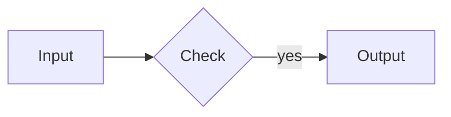

# MCSOG-Docs

[中文](./README.md) | English

---

## English

The **public documentation repository** for the MCSOG Minecraft server-hosting guide. Community contributions are welcome.

*Online sites pull from the repository every 10 minutes.

Live site: <https://mcsog.ndpreforged.com>

### Repository layout

```
MCSOG-Docs/
├── README.md              this file
├── README_EN.md           English README
├── docslist.json          tutorial nav + document index (tutorials only)
└── docs/
    ├── zh/                Simplified Chinese (source of truth)
    │   ├── tutorials/     tutorials
    │   │   ├── java/      Java Edition
    │   │   ├── bedrock/   Bedrock Edition
    │   │   ├── ops/       operations and security
    │   │   └── faq/       frequently asked questions
    │   ├── wiki/          wiki (version timeline, core comparison, commands)
    │   ├── help/          help and policies
    ├── en/                English (mirrors the zh tree one to one)
    ├── zh-TW/             Traditional Chinese
    ├── ja-JP/             Japanese
    ├── ru-RU/             Russian
    ├── ar/                Arabic
    └── vi/                Vietnamese
```

All locales other than `zh` use the same `tutorials/`, `wiki/`, and `help/` layout as `zh`.

### docslist.json structure

`docslist.json` manages tutorial content only. Its top level contains only `nav` and `docs`; the old `type → category → language` manifest format is no longer supported.

- `nav`: tutorial navigation entries matching the site sidebar (Overview, Java Server, Bedrock Server, Ops & Security, FAQ)
- `docs`: tutorial document index with exactly four categories: `java`, `be`, `ops`, `faq` (`be` maps to the on-disk `bedrock` directory)

```json
{
  "nav": [
    {
      "key": "tutorials",
      "icon": "book-open",
      "path": "/tutorials",
      "label": { "zh": "教程总览", "en": "Overview" },
      "sub": { "zh": "OVERVIEW", "en": "OVERVIEW" }
    }
  ],
  "docs": {
    "java": {
      "en": [
        {
          "path": "/en/tutorials/java/example",
          "title": "Example tutorial",
          "slug": "example",
          "cat": "java",
          "updated": "2026-11-03",
          "level": 1,
          "minute": 10,
          "order": 1
        }
      ]
    }
  }
}
```

Every document entry requires `path`, `slug`, `title`, `cat`, `updated`, `level`, `minute`, and `order`; optional fields include `mc`, `tags`, and `draft`. Entries are ordered by ascending `order`.

Add, delete, or rename a tutorial together with its `docslist.json` entry. The site reads this file; `help`, `wiki`, and `news` are loaded by filesystem scan and are not written here. Legacy full-manifest format is no longer supported.

The site syncs documents and `docslist.json` from this repository every 10 minutes. If both the private repository and the public repository changed `docslist.json`, the local version is kept and the conflict is handed to the site's built-in conflict manager instead of being silently overwritten. New tutorials created in the web editor write both Markdown and `docslist.json`; Git pushes run through the background queue, and docslist conflicts in that queue use the same built-in conflict manager without blocking the save request.

### Path conventions

| Path | Content |
| --- | --- |
| `docs/zh/tutorials/<category>/<slug>.md` | Chinese tutorial, category is `java` / `bedrock` / `ops` / `faq` |
| `docs/en/tutorials/<category>/<slug>.md` | English tutorial, mirrors the Chinese path exactly |
| `docs/zh/wiki/<name>.md` | Chinese wiki entry |
| `docs/<locale>/...` | Same tree for `en` / `zh-TW` / `ja-JP` / `ru-RU` / `ar` / `vi` |

### Writing rules

- **Markdown**; UTF-8 without BOM; **LF** line endings; exactly **one** trailing newline
- Start headings at `##` (`#` is reserved for the page title); section anchors are generated
  by the site as `mcsog-h-<heading>`
- Use **absolute** internal links (for example `/wiki/compare`); add an anchor to target a
  section (for example `/wiki/compare#mcsog-h-基岩版核心对比`)
- Keep Chinese and English **in sync**: when you edit `docs/zh/...`, update `docs/en/...` too
- Version numbers, commands and download URLs must match **official sources**, with a link to check
- When quoting third-party material, credit the source and its licence

### Content extensions

Besides standard Markdown, the site supports a set of body enhancements. Everything available is listed below, by category.

#### Basics

| Syntax | Result |
| --- | --- |
| `# Heading` | Levels 1-6, feeding the table of contents |
| `**bold**` / `*italic*` / `~~struck~~` | Inline styles |
| `` `code` `` | Inline code |
| `[text](url)` | Link |
| `` | Image |
| `---` | Horizontal rule |
| `\| table \|` | Table, second row is the divider |
| ```` ```lang ```` | Fenced code block with a language label and a copy button |

#### Lists

Dashes, asterisks and plus signs all start an unordered list, and they nest. A number followed by a dot or a closing bracket starts an ordered list.

```markdown
- Dashed item
  - Nested item
    - Third level

* Asterisk item

+ Plus item

1. First ordered item
   1. Nested ordered item
```

A GFM task list uses `- [ ]` for open and `- [x]` or `- [X]` for done:

```markdown
- [ ] Not done yet
- [x] Done
- [X] Capital X also works
```

#### Highlight

Wrap text in `==...==` to mark it, which renders as a yellow highlight:

```markdown
This is ==the important part==, the rest is ordinary text.
```

#### Image size and alignment

Append `#size=` or `#align=` to the image URL. The two can be combined.

| Syntax | Result |
| --- | --- |
| `` | Natural size, never wider than the column |
| `` | Fixed 320x180 pixels |
| `` | 50% of the column width |
| `` | Centred |
| `` | Right aligned |
| `` | Left aligned |
| `` | Both together |

#### Audio and video

`` embeds an audio player and `` a video player. A video accepts `.h=height.w=width` after the URL to set its size.

```markdown


.h=270.w=480
```

#### Note blocks

Open with `:::note Title` and close with a line containing only `:::`. `:::tip`, `:::warn`, `:::danger` and `:::step` work the same way.

```markdown
:::note Note
This is a note block.
:::

:::warn
Do not run the server as root.
:::
```

A quote works too: one letter after `>` picks the kind, and a space after the letter is allowed.

| Syntax | Kind | Colour |
| --- | --- | --- |
| `> text` | Plain quote | Grey |
| `> i text` or `>i text` | Info | Blue |
| `> d text` or `>d text` | Danger | Red |
| `> w text` or `>w text` | Warning | Amber |
| `> s text` or `>s text` | Success | Green |

#### Step list

Consecutive `:::step` blocks merge into a numbered sequence.

```markdown
:::step Install the runtime
Run `apt install openjdk-21-jre-headless`.
:::

:::step Start the service
Put the jar in `/opt/mc` and run the start script.
:::
```

#### Maths

Wrap inline maths in single dollar signs and a display formula in double dollar signs. The full KaTeX language is available.

```markdown
Inline: $E = mc^2$

Display:

$$
\int_{0}^{1} x^{2}\,dx = \frac{1}{3}
$$
```

#### Flowchart

A `flow` block takes flowchart.js syntax:

````markdown
```flow
st=>start: Start
op=>operation: Work
cond=>condition: Pass?
e=>end: Done

st->op->cond
cond(yes)->e
cond(no)->op
```
````

#### Sequence diagram

A `seq` block takes js-sequence-diagrams syntax: `->` is solid, `-->` is dashed:

````markdown
```seq
Client->Server: request
Server-->Client: response
```
````

#### Mermaid

A `mermaid` block takes Mermaid syntax directly: flowcharts, sequence diagrams, class diagrams, state diagrams, pie charts and more:

````markdown

````

#### Mind map

A `mindmap` block starts with the word `mindmap`, and indentation sets the hierarchy. The result can be dragged and zoomed with the wheel.

````markdown
```mindmap
mindmap
  root((Topic))
    Branch
      Leaf
```
````

#### Timeline

A `timeline` block takes one entry per line as `date: text`:

````markdown
```timeline
2026-09-01: Site launch
2026-11-24: New renderer
```
````

#### Charts

An `echarts` block takes an ECharts option object as JSON:

````markdown
```echarts
{
  "xAxis": { "type": "category", "data": ["A", "B", "C"] },
  "yAxis": { "type": "value" },
  "series": [{ "type": "bar", "data": [10, 20, 15] }]
}
```
````

#### HTML entities

Standard HTML entities are supported and render as the character they name, for example `&copy;` &copy;, `&times;` &times;, `&frac34;` &frac34;, `18&ordm;C` 18&ordm;C. Decimal and hexadecimal forms work as well, such as `&#169;`. An `&` that does not form an entity is escaped automatically.

### HTML embed extension

`html.()` embeds raw HTML in Markdown while keeping HTML/JS execution. Content is isolated in Shadow DOM by default so its CSS cannot affect the site layout, spacing, or colors.

Full example:

```text
html.csp=[example.com,*.example.org].L=640.H=360.(<div>...</div>)
```

Parameters:

- `csp=[...]`: domains the block may load from, `*.example.com` wildcards allowed. With it the block runs in an isolated iframe under a CSP; without it, a Shadow DOM.
- `L` / `H`: width / height in pixels. Both or neither; one alone is ignored.
- Parameter names are case-insensitive.
- JS inside `html.()` does run, so only embed content you trust.

### Sync rules

This repository is the public source. The private main repository receives it one way:

```text
MCSOG-Docs/docs + docslist.json
        ↓ every 10 minutes
private main repository docs/ + docslist.json
        ↓
site release
```

- Added/modified/deleted public documents are mirrored into the private repository.
- `docs/*/news/` is not maintained here and is never deleted from the private repository by this mirror.
- `docs/ad/` is not synced.
- Destructive mirrors are guarded: more than five deletions abort the sync.
### Contributing

1. Fork this repository
2. Create a branch and edit `docs/<locale>/**` (`zh` / `en` / `zh-TW` / `ja-JP` / `ru-RU` / `ar` / `vi`)
3. Open a pull request explaining **what** changed and **why**
4. After the maintainers merge it into `main`, it takes effect automatically:
   - synced into the main repository **within 10 minutes**
   - deployed to the live site **within 2 hours**

### Licence

Documentation is licensed under **CC BY-SA 4.0**; code samples are under **MIT**.
