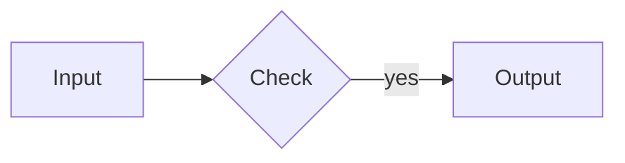

يُخزَّن محتوى هذا الموقع بصيغة Markdown، وكلّه موجود في المستودع العام [MCSOG-Docs](https://github.com/Minecraft-Server-Opening-Guide/MCSOG-Docs)، ويمكن لأي شخص تقديم تعديلات.

## الدلائل والتسمية

| النوع | المسار |
| --- | --- |
| الدروس | `docs/zh/tutorials/<category>/<slug>.md`، والتصنيف `java` / `bedrock` / `ops` / `faq` |
| الموسوعة | `docs/zh/wiki/<name>.md` |
| الإعلانات | المستودع الخاص `docs/ar/news/<name>.md` (ليس في المستودع العام) |
| المساعدة | `docs/zh/help/<name>.md` |

## docslist.json ومستندات الدروس

يدير `docslist.json` محتوى الدروس فقط. `nav` هو تنقل الدروس في الشريط الجانبي (نظرة عامة، خادم Java، خادم Bedrock، التشغيل والأمان، الأسئلة الشائعة)؛ `docs` فهرس الدروس بفئات `java` و`be` و`ops` و`faq` (يقابل `be` مجلد `bedrock`). لا تكتب `help` أو `wiki` أو `news` هنا.

```json
{
  "nav": [
    { "key": "tutorials", "icon": "book-open", "path": "/tutorials", "label": { "zh": "教程总览", "en": "Overview" }, "sub": { "zh": "OVERVIEW", "en": "OVERVIEW" } }
  ],
  "docs": {
    "java": {
      "ar": [
        { "path": "/ar/tutorials/java/example", "title": "درس تجريبي", "slug": "example", "cat": "java", "updated": "2026-11-03", "level": 1, "minute": 10, "order": 1 }
      ]
    }
  }
}
```

`path` هو مسار الدرس داخل الموقع، ويجب أن يطابق `slug` اسم ملف Markdown. عند إضافة درس، أرسل ملف Markdown وسجّل العنصر تحت الفئة واللغة المناسبتين.

تقابل الملفات الإنجليزية الملفات الصينية **مسارًا بمسار**، مع استبدال `zh` بـ `en` فقط.
يُكتب `<slug>` بحروف إنجليزية صغيرة وشرطات، ويصبح الجزء الأخير من مسار URL للصفحة؛ ويجب أن يطابق اسم الملف قيمة `slug`.

يحتاج ملف الدرس إلى YAML front-matter في بدايته:

```yaml
---
title: نشر خادم Paper على Linux
slug: linux-paper
cat: java
level: 2
minutes: 15
mc: ["1.21.x", "1.20.4"]
tags: [linux, paper, systemd]
updated: 2026-10-06
draft: false
---
```

| الحقل | المعنى |
| --- | --- |
| `title` | عنوان الصفحة والقائمة |
| `slug` | اسم الملف دون `.md`، وهو أيضًا أحد مقاطع URL |
| `cat` | دليل التصنيف: `java` / `bedrock` / `ops` / `faq` |
| `level` | الصعوبة من 1 إلى 3، تُعرض كوسم |
| `minutes` | زمن القراءة المتوقّع بالدقائق |
| `mc` | إصدارات Minecraft المناسبة |
| `tags` | الوسوم، ويستخدمها البحث داخل الموقع أيضًا |
| `updated` | `YYYY-MM-DD`، وتُرتَّب القوائم بحسبه |
| `draft` | عند ضبطه على `true` لا تُنشر الصفحة |

## إضافات النص

يدعم عارض Markdown صيغة Markdown القياسية وإضافات GFM ومجموعة من تحسينات النص. فيما يلي كل ما هو متاح مرتبًا حسب الفئة.

### الأساسيات

| الصيغة | النتيجة | مثال |
| --- | --- | --- |
| `# عنوان` | عناوين من 1 إلى 6 وتظهر في الفهرس على اليمين | `## التثبيت` |
| `**عريض**` | عريض | **عريض** |
| `*مائل*` | مائل | *مائل* |
| `~~يتوسطه خط~~` | يتوسطه خط | ~~يتوسطه خط~~ |
| `` `شفرة` `` | شفرة داخل السطر | `npm install` |
| `[نص](رابط)` | رابط | [الرئيسية](/) |
| `` | صورة | انظر قسم الصور أدناه |
| `---` | خط فاصل | |
| `| جدول |` | جدول، السطر الثاني هو الفاصل | انظر الجدول أعلاه |
| ```` ```lang ```` | كتلة شفرة بلغة محددة وزر نسخ | انظر أدناه |

### القوائم

يمكن استخدام الشرطة أو النجمة أو علامة الزائد لقائمة غير مرقمة، وهي قابلة للتداخل. الرقم متبوعًا بنقطة أو قوس يبدأ قائمة مرقمة.

```markdown
- عنصر بشرطة
- العنصر الثاني
  - عنصر متداخل
    - المستوى الثالث

* عنصر بنجمة
* العنصر الثاني

+ عنصر بزائد
+ العنصر الثاني

1. العنصر الأول
2. العنصر الثاني
   1. عنصر متداخل
3. العنصر الثالث
```

قائمة مهام GFM تستخدم `- [ ]` لغير المنجز و`- [x]` أو `- [X]` للمنجز:

```markdown
- [ ] غير منجز
- [x] منجز
- [X] الحرف الكبير X يعمل أيضًا
```

كما تظهر:

- [ ] غير منجز
- [x] منجز
- [X] الحرف الكبير X يعمل أيضًا

### الإبراز

ضع النص بين `==...==` ليظهر بخلفية صفراء:

```markdown
هذا هو ==الجزء المهم==، والباقي نص عادي.
```

كما تظهر:

هذا هو ==الجزء المهم==، والباقي نص عادي.

### حجم الصورة ومحاذاتها

أضف `#size=` أو `#align=` بعد عنوان الصورة، ويمكن الجمع بينهما.

| الصيغة | النتيجة |
| --- | --- |
| `` | الحجم الأصلي دون تجاوز عرض العمود |
| `` | 320×180 بكسل ثابتة |
| `` | 50% من عرض العمود |
| `` | في الوسط |
| `` | إلى اليمين |
| `` | إلى اليسار |
| `` | الاثنان معًا |

```markdown

```

### الصوت والفيديو

`` يضمّن مشغل صوت، و`` يضمّن مشغل فيديو. ويمكن إضافة `.h=الارتفاع.w=العرض` بعد العنوان لضبط الحجم.

```markdown


.h=270.w=480
```

### كتل التنبيه

:::note ملاحظة
تبدأ بـ `:::note العنوان` وتنتهي بسطر يحتوي على `:::` فقط. وتعمل `:::tip` و`:::warn` و`:::danger` بالطريقة نفسها.
:::

```markdown
:::note ملاحظة
هذه كتلة note.
:::

:::tip نصيحة
هذه كتلة tip.
:::

:::warn تحذير
هذه كتلة warn.
:::

:::danger خطر
هذه كتلة danger.
:::
```

يمكن استخدام صيغة الاقتباس أيضًا: حرف واحد بعد `>` يحدد النوع، ويُسمح بمسافة بعد الحرف.

| الصيغة | النوع | اللون |
| --- | --- | --- |
| `> نص` | اقتباس عادي | رمادي |
| `> i نص` أو `>i نص` | معلومة | أزرق |
| `> d نص` أو `>d نص` | خطر | أحمر |
| `> w نص` أو `>w نص` | تحذير | برتقالي |
| `> s نص` أو `>s نص` | نجاح | أخضر |

> هكذا يبدو الاقتباس العادي.

> i هذه كتلة معلومة.

> d هذه كتلة خطر.

> w هذه كتلة تحذير.

> s هذه كتلة نجاح.

### الخطوات

:::step ملاحظة
تبدأ بـ `:::step العنوان` وتنتهي بسطر يحتوي على `:::` فقط. وتُدمج الخطوات المتتالية في تسلسل مرقم.
:::

```markdown
:::step الخطوة الأولى
نزّل ملف الخادم.
:::

:::step الخطوة الثانية
حرّر ملف server.properties.
:::
```

### المعادلات

تُحاط المعادلة السطرية بعلامة دولار واحدة، والمعادلة المستقلة بعلامتين.

```markdown
$E=mc^2$

$$
\int_{0}^{1} x^{2}\,dx = \frac{1}{3}
$$
```

يتوفر كامل لغة KaTeX بما في ذلك المصفوفات والحالات والمجاميع والتكاملات:

$$
\begin{pmatrix} a & b \\ c & d \end{pmatrix}
\begin{pmatrix} x \\ y \end{pmatrix}
=
\begin{pmatrix} ax+by \\ cx+dy \end{pmatrix}
$$

### مخطط سير العمل

تأخذ كتلة `flow` صيغة flowchart.js:

````markdown
```flow
st=>start: Start
op=>operation: Work
cond=>condition: Pass?
e=>end: Done

st->op->cond
cond(yes)->e
cond(no)->op
```
````

```flow
st=>start: Start
op=>operation: Work
cond=>condition: Pass?
e=>end: Done

st->op->cond
cond(yes)->e
cond(no)->op
```

### مخطط التسلسل

تأخذ كتلة `seq` صيغة js-sequence-diagrams: الرمز `->` خط متصل و`-->` خط متقطع:

````markdown
```seq
Client->Server: request
Server-->Client: response
```
````

```seq
Client->Server: request
Server-->Client: response
```

### Mermaid

تأخذ كتلة `mermaid` صيغة Mermaid مباشرة: مخططات سير العمل والتسلسل والفئات والحالات وغيرها:

````markdown

````


### الخريطة الذهنية

تستخدم كتلة `mindmap`، ويُكتب `mindmap` في السطر الأول، والمسافات البادئة تحدد المستويات:

````markdown
```mindmap
mindmap
  root((Topic))
    Branch
      Leaf
```
````

```mindmap
mindmap
  root((MCSOG))
    Tutorials
      Java
      Bedrock
    Resources
      Mods
      Plugins
```

### الخط الزمني

تستخدم كتلة `timeline`، بإدخال واحد في كل سطر بصيغة `التاريخ: النص`:

````markdown
```timeline
2026-09-01: Site launch
2026-11-24: New renderer
```
````

```timeline
2026-09-01: Site launch
2026-11-14: Notifications
2026-11-24: Renderer extended
```

### الرسوم البيانية

تأخذ كتلة `echarts` كائن إعدادات ECharts بصيغة JSON:

````markdown
```echarts
{
  "xAxis": { "type": "category", "data": ["A", "B", "C"] },
  "yAxis": { "type": "value" },
  "series": [{ "type": "bar", "data": [10, 20, 15] }]
}
```
````

```echarts
{
  "xAxis": { "type": "category", "data": ["A", "B", "C"] },
  "yAxis": { "type": "value" },
  "series": [{ "type": "bar", "data": [10, 20, 15], "itemStyle": { "color": "#8ec91d" } }]
}
```

### كيانات HTML

تدعم كيانات HTML القياسية وتظهر بالرمز المقابل:

| Entity | Renders | Entity | Renders |
| --- | --- | --- | --- |
| `&copy;` | &copy; | `&reg;` | &reg; |
| `&trade;` | &trade; | `&uml;` | &uml; |
| `&iexcl;` | &iexcl; | `&pound;` | &pound; |
| `&yen;` | &yen; | `&euro;` | &euro; |
| `&plusmn;` | &plusmn; | `&para;` | &para; |
| `&sect;` | &sect; | `&brvbar;` | &brvbar; |
| `&macr;` | &macr; | `&laquo;` | &laquo; |
| `&raquo;` | &raquo; | `&middot;` | &middot; |
| `&sup2;` | &sup2; | `&sup3;` | &sup3; |
| `&frac34;` | &frac34; | `&frac14;` | &frac14; |
| `&times;` | &times; | `&divide;` | &divide; |
| `&ordm;` | &ordm; | `&quot;` | &quot; |
| `&apos;` | &apos; | `&amp;` | &amp; |
| `&lt;` | &lt; | `&gt;` | &gt; |

تعمل أيضًا الصيغ العددية: `&#169;` تظهر &#169;.

علامة `&` التي لا تشكل كيانًا تُهرَّب تلقائيًا فلا يمكن أن تفسد الصفحة.

## تكلفة العرض

يتم العرض على الخادم. وتحمّل الصفحة المحركات اللازمة فقط (KaTeX وMermaid وECharts) بحسب الصيغ المستخدمة، أما المقال العادي فلا يحمّل أيًا منها.

## تضمين HTML

يضمّن `html.()` شفرة HTML خامة داخل Markdown ويحافظ على تنفيذ HTML/JS. يوضع المحتوى في Shadow DOM كي لا تؤثر أنماطه على تنسيق الموقع. وأي وسم HTML آخر يُهرَّب ولا يُنفَّذ.

مثال كامل:

```text
html.csp=[example.com,*.example.org].L=640.H=360(<div>...</div>)
```

المعاملات:

- `csp=[...]`: قائمة النطاقات المسموح التحميل منها، مع دعم `*.example.com`. بوجودها يعمل المحتوى داخل iframe معزول مع CSP، وبدونها داخل Shadow DOM.
- `L` / `H`: العرض / الارتفاع بالبكسل. يجب ذكرهما معًا؛ أحدهما وحده يُتجاهل.
- أسماء المعاملات غير حساسة لحالة الأحرف.
- شفرة JS داخل `html.()` تُنفَّذ فعلاً، لذا ضمّن محتوى موثوقًا فقط.

## امتداد تضمين HTML

يسمح `html.()` بتضمين HTML خام داخل Markdown مع الحفاظ على تنفيذ HTML/JS. يُعزل المحتوى افتراضيًا داخل Shadow DOM حتى لا تؤثر CSS الداخلية في تخطيط الموقع أو المسافات أو الألوان.
خارج `html.()`، تُحوَّل وسوم HTML العادية إلى نص ولا تُنفَّذ.

مثال كامل:

```text
html.csp=[example.com,*.example.org].L=640.H=360(<div>...</div>)
```

المعاملات:

- `csp=[...]`: قائمة النطاقات المسموح بها، وتدعم النمط `*.example.com`. عند وجودها يُستخدم iframe معزول مع CSP، وإلا يُستخدم Shadow DOM.
- `L` / `H`: العرض / الارتفاع بالبكسل. يجب وجودهما معًا؛ وجود واحد فقط يُلغي المعامل ويصبح الحجم تلقائيًا.
- أسماء المعاملات غير حساسة لحالة الأحرف.
- يتم تنفيذ JS داخل `html.()`؛ ضمّن محتوى موثوقًا فقط.

## طريقة التقديم

:::step إنشاء فرع في المستودع
اعمل Fork لمستودع [MCSOG-Docs](https://github.com/Minecraft-Server-Opening-Guide/MCSOG-Docs) ثم أنشئ فرعًا جديدًا، وأضف الملفات وفق الدلائل والتسمية أعلاه.
:::

:::step تقديم Pull Request
وضّح في PR **نطاق التعديل**.
:::

:::note
يسري المحتوى تلقائيًا بعد دمجه في `main`: تُزامن التغييرات خلال 30 دقيقة في المستودع الرئيسي، وتُطلق خلال ساعتين.
:::

قواعد الكتابة والاقتباس في [المساهمة وقواعدها](/help/contribute).
