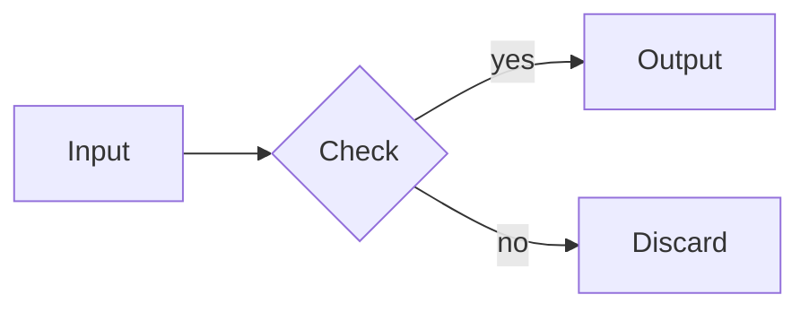

All content lives as plain Markdown in the public repository [MCSOG-Docs](https://github.com/Minecraft-Server-Opening-Guide/MCSOG-Docs), so anyone can propose a change.

## Layout and naming

| Kind | Path |
| --- | --- |
| Tutorial | `docs/en/tutorials/<category>/<slug>.md`, category is `java` / `bedrock` / `ops` / `faq` |
| Wiki | `docs/en/wiki/<name>.md` |
| News | Private repo `docs/en/news/<name>.md` (not in public repo) |
| Help | `docs/en/help/<name>.md` |

## docslist.json and tutorial documents

`docslist.json` manages tutorial content only. `nav` is the sidebar tutorial navigation (Overview, Java Server, Bedrock Server, Ops & Security, FAQ); `docs` is the tutorial document index with exactly four categories: `java`, `be`, `ops`, and `faq` (`be` maps to the on-disk `bedrock` directory). `help`, `wiki`, and `news` must not be written here.

```json
{
  "nav": [
    { "key": "tutorials", "icon": "book-open", "path": "/tutorials", "label": { "zh": "教程总览", "en": "Overview" }, "sub": { "zh": "OVERVIEW", "en": "OVERVIEW" } }
  ],
  "docs": {
    "java": {
      "en": [
        { "path": "/en/tutorials/java/example", "title": "Example tutorial", "slug": "example", "cat": "java", "updated": "2026-11-03", "level": 1, "minute": 10, "order": 1 }
      ]
    }
  }
}
```

`path` is the in-site tutorial path; `slug` must match the Markdown file name. Add the Markdown file and register the entry under the matching category and language when adding a tutorial.

The English file **mirrors the Chinese path exactly**, with `zh` replaced by `en`.
Use lowercase ASCII with hyphens for `<slug>`: it becomes the last URL segment, and the file name must match the `slug` field.

Every tutorial starts with YAML front-matter:

```yaml
---
title: Deploying a Paper Server on Linux
slug: linux-paper
cat: java
level: 2
minutes: 15
mc: ["1.21.x", "1.20.4"]
tags: [linux, paper, systemd]
updated: 2026-10-06
draft: false
---
```

| Field | Meaning |
| --- | --- |
| `title` | Page and list title |
| `slug` | File name without `.md`, also the URL segment |
| `cat` | Category folder: `java` / `bedrock` / `ops` / `faq` |
| `level` | Difficulty 1-3, shown as a tag |
| `minutes` | Estimated reading time in minutes |
| `mc` | Supported Minecraft versions |
| `tags` | Tags, also used by site search |
| `updated` | `YYYY-MM-DD`; listings sort by it |
| `draft` | `true` keeps the page offline |

## Body extensions

The Markdown renderer supports standard Markdown, the GFM extensions, and a set of body enhancements. Everything available is listed below, by category.

### Basics

| Syntax | Result | Example |
| --- | --- | --- |
| `# Heading` | Levels 1-6, feeding the table of contents | `## Install` |
| `**bold**` | Bold | **bold** |
| `*italic*` | Italic | *italic* |
| `~~struck~~` | Strikethrough | ~~struck~~ |
| `` `code` `` | Inline code | `npm install` |
| `[text](url)` | Link | [Home](/) |
| `` | Image | see Images below |
| `---` | Horizontal rule | |
| `\| table \|` | Table, second row is the divider | see above |
| ```` ```lang ```` | Fenced code block with a language label and a copy button | see below |

### Lists

Dashes, asterisks and plus signs all start an unordered list, and they nest. A number followed by a dot or a closing bracket starts an ordered list.

```markdown
- Dashed item
- Second item
  - Nested item
    - Third level

* Asterisk item
* Second item

+ Plus item
+ Second item

1. First ordered item
2. Second ordered item
   1. Nested ordered item
3. Third ordered item
```

A GFM task list uses `- [ ]` for open and `- [x]` or `- [X]` for done:

```markdown
- [ ] Not done yet
- [x] Done
- [X] Capital X also works
```

Rendered:

- [ ] Not done yet
- [x] Done
- [X] Capital X also works

### Highlight

Wrap text in `==...==` to mark it, which renders as a yellow highlight:

```markdown
This is ==the important part==, the rest is ordinary text.
```

Rendered:

This is ==the important part==, the rest is ordinary text.

### Image size and alignment

Append `#size=` or `#align=` to the image URL. The two can be combined.

| Syntax | Result |
| --- | --- |
| `` | Natural size, never wider than the column |
| `` | Fixed 320x180 pixels |
| `` | 50% of the column width |
| `` | Centred |
| `` | Right aligned |
| `` | Left aligned |
| `` | Both together |

```markdown

```

### Audio and video

`` embeds an audio player and `` a video player. A video accepts `.h=height.w=width` after the URL to set its size.

```markdown


.h=270.w=480
```

### Note blocks

:::note Note
Open with `:::note Title` and close with a line containing only `:::`. `:::tip`, `:::warn` and `:::danger` work the same way.
:::

```markdown
:::note Note
This is a note block.
:::

:::tip Tip
This is a tip block.
:::

:::warn Warning
This is a warning block.
:::

:::danger Danger
This is a danger block.
:::
```

A quote works too: one letter after `>` picks the kind, and a space after the letter is allowed.

| Syntax | Kind | Colour |
| --- | --- | --- |
| `> text` | Plain quote | Grey |
| `> i text` or `>i text` | Info | Blue |
| `> d text` or `>d text` | Danger | Red |
| `> w text` or `>w text` | Warning | Amber |
| `> s text` or `>s text` | Success | Green |

> A plain quote looks like this.

> i This is an info note.

> d This is a danger note.

> w This is a warning note.

> s This is a success note.

### Step list

:::step Note
Open with `:::step Title` and close with a line containing only `:::`. Consecutive step blocks merge into a numbered sequence.
:::

```markdown
:::step Step one
Download the server jar.
:::

:::step Step two
Edit server.properties.
:::
```

### Maths

Wrap inline maths in single dollar signs and a display formula in double dollar signs.

```markdown
Inline: $E=mc^2$.

Display:

$$
\int_{0}^{1} x^{2}\,dx = \frac{1}{3}
$$
```

The full KaTeX language is available, including matrices, cases, sums and integrals:

$$
\begin{pmatrix} a & b \\ c & d \end{pmatrix}
\begin{pmatrix} x \\ y \end{pmatrix}
=
\begin{pmatrix} ax+by \\ cx+dy \end{pmatrix}
$$

### Flowchart

A `flow` block takes flowchart.js syntax:

````markdown
```flow
st=>start: Start
op=>operation: Work
cond=>condition: Pass?
e=>end: Done

st->op->cond
cond(yes)->e
cond(no)->op
```
````

```flow
st=>start: Start
op=>operation: Work
cond=>condition: Pass?
e=>end: Done

st->op->cond
cond(yes)->e
cond(no)->op
```

### Sequence diagram

A `seq` block takes js-sequence-diagrams syntax: `->` is solid, `-->` is dashed:

````markdown
```seq
Client->Server: request
Server-->Client: response
```
````

```seq
Client->Server: request
Server-->Client: response
```

### Mermaid

A `mermaid` block takes Mermaid syntax directly: flowcharts, sequence diagrams, class diagrams, state diagrams and more:

````markdown

````


### Mind map

A `mindmap` block starts with the word `mindmap`, and indentation sets the hierarchy:

````markdown
```mindmap
mindmap
  root((Topic))
    Branch
      Leaf
```
````

```mindmap
mindmap
  root((MCSOG))
    Tutorials
      Java
      Bedrock
    Resources
      Mods
      Plugins
```

### Timeline

A `timeline` block takes one entry per line as `date: text`:

````markdown
```timeline
2026-09-01: Site launch
2026-11-24: New renderer
```
````

```timeline
2026-09-01: Site launch
2026-11-14: Notifications
2026-11-24: Renderer extended
```

### Charts

An `echarts` block takes an ECharts option object as JSON:

````markdown
```echarts
{
  "xAxis": { "type": "category", "data": ["A", "B", "C"] },
  "yAxis": { "type": "value" },
  "series": [{ "type": "bar", "data": [10, 20, 15] }]
}
```
````

```echarts
{
  "xAxis": { "type": "category", "data": ["Jan", "Feb", "Mar"] },
  "yAxis": { "type": "value" },
  "series": [{ "type": "bar", "data": [120, 200, 150], "itemStyle": { "color": "#8ec91d" } }]
}
```

### HTML entities

Standard HTML entities are supported and render as the character they name:

| Entity | Renders | Entity | Renders |
| --- | --- | --- | --- |
| `&copy;` | &copy; | `&reg;` | &reg; |
| `&trade;` | &trade; | `&uml;` | &uml; |
| `&iexcl;` | &iexcl; | `&pound;` | &pound; |
| `&yen;` | &yen; | `&euro;` | &euro; |
| `&plusmn;` | &plusmn; | `&para;` | &para; |
| `&sect;` | &sect; | `&brvbar;` | &brvbar; |
| `&macr;` | &macr; | `&laquo;` | &laquo; |
| `&raquo;` | &raquo; | `&middot;` | &middot; |
| `&sup2;` | &sup2; | `&sup3;` | &sup3; |
| `&frac34;` | &frac34; | `&frac14;` | &frac14; |
| `&times;` | &times; | `&divide;` | &divide; |
| `&ordm;` | &ordm; | `&quot;` | &quot; |
| `&apos;` | &apos; | `&amp;` | &amp; |
| `&lt;` | &lt; | `&gt;` | &gt; |

Decimal and hexadecimal forms work as well: `&#169;` renders as &#169; and `&#xA9;` as &#xA9;.

An `&` that does not form an entity is escaped automatically, so it cannot break the page.

## Rendering cost

Rendering happens on the server and the result is cached by the browser. A page that actually contains maths, a diagram or a chart loads the matching renderer (KaTeX, Mermaid, ECharts) on demand; an ordinary article loads none of them, so it pays nothing for the new syntax.

## HTML embedding

`html.()` embeds raw HTML in Markdown and keeps HTML/JS execution. The content goes into a Shadow DOM so its CSS cannot affect the site layout, and any other HTML tag is escaped rather than executed.

Full example:

```text
html.csp=[example.com,*.example.org].L=640.H=360(<div>...</div>)
```

Parameters:

- `csp=[...]`: domains the block may load from, `*.example.com` wildcards allowed. With it the block runs in an isolated iframe under a CSP; without it, a Shadow DOM.
- `L` / `H`: width / height in pixels. Both or neither; one alone is ignored.
- Parameter names are case-insensitive.
- JS inside `html.()` does run, so only embed content you trust.

## HTML embed extension

`html.()` embeds raw HTML in Markdown while keeping HTML/JS execution. Content is isolated in Shadow DOM by default so its CSS cannot affect the site layout, spacing, or colors.
Outside `html.()`, ordinary HTML tags are escaped as text and are not executed.

Full example:

```text
html.csp=[example.com,*.example.org].L=640.H=360(<div>...</div>)
```

Parameters:

- `csp=[...]`: allowed domains, with `*.example.com` wildcard support. When present, content runs in an isolated iframe with a CSP; otherwise Shadow DOM is used.
- `L` / `H`: width / height in px. Both must be present; a single value is ignored and the size becomes automatic.
- Parameter names are case-insensitive.
- JavaScript inside `html.()` runs; only embed trusted content.

## How to submit

:::step Create a branch in the repository
Fork [MCSOG-Docs](https://github.com/Minecraft-Server-Opening-Guide/MCSOG-Docs) and create a branch, then add files following the layout above.
:::

:::step Open a pull request
Describe the **scope of the change**.
:::

:::note
Once merged into `main` it takes effect automatically: into the main repository within 30 minutes, live within 2 hours.
:::

See [Contribution and rules](/help/contribute) for the writing rules.
