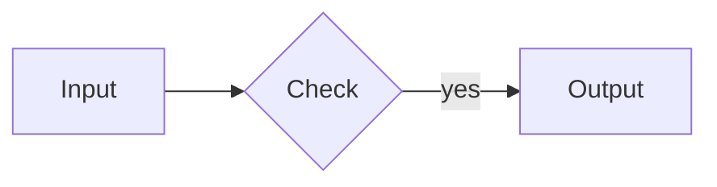

当サイトのコンテンツはすべて Markdown 形式で保存されており、公開リポジトリ [MCSOG-Docs](https://github.com/Minecraft-Server-Opening-Guide/MCSOG-Docs) に置かれています。どなたでも修正を提案できます。

## ディレクトリと命名

| 種類 | パス |
| --- | --- |
| チュートリアル | `docs/zh/tutorials/<分類>/<slug>.md`、分類は `java` / `bedrock` / `ops` / `faq` |
| 百科 | `docs/zh/wiki/<name>.md` |
| お知らせ | プライベートリポジトリ `docs/ja-JP/news/<name>.md`（公開リポジトリには置かない） |
| ヘルプ | `docs/zh/help/<name>.md` |

## docslist.json とチュートリアル文書

`docslist.json` はチュートリアルだけを管理します。`nav` はサイドバーのチュートリアルナビゲーション（概要、Java サーバー、Bedrock サーバー、運用とセキュリティ、FAQ）、`docs` はチュートリアル索引で、分類は `java`、`be`、`ops`、`faq` に固定されています（`be` は `bedrock` ディレクトリに対応）。`help`、`wiki`、`news` はここに書きません。

```json
{
  "nav": [
    { "key": "tutorials", "icon": "book-open", "path": "/tutorials", "label": { "zh": "教程总览", "en": "Overview" }, "sub": { "zh": "OVERVIEW", "en": "OVERVIEW" } }
  ],
  "docs": {
    "java": {
      "ja-JP": [
        { "path": "/ja-JP/tutorials/java/example", "title": "サンプルチュートリアル", "slug": "example", "cat": "java", "updated": "2026-11-03", "level": 1, "minute": 10, "order": 1 }
      ]
    }
  }
}
```

`path` はサイト内のチュートリアルパス、`slug` は Markdown のファイル名と一致させます。追加時は Markdown を提出し、対応する分類と言語に項目を登録してください。

英語版のファイルは中国語版と**パスが一対一で対応**しており、`zh` を `en` に置き換えるだけです。
`<slug>` は小文字の英字とハイフンで指定し、ページ URL の最後のセグメントになります。ファイル名と `slug` は必ず一致させてください。

チュートリアルのファイルは、先頭に YAML front-matter が必要です：

```yaml
---
title: Linux での Paper サーバーの構築
slug: linux-paper
cat: java
level: 2
minutes: 15
mc: ["1.21.x", "1.20.4"]
tags: [linux, paper, systemd]
updated: 2026-10-06
draft: false
---
```

| フィールド | 意味 |
| --- | --- |
| `title` | ページと一覧のタイトル |
| `slug` | ファイル名から `.md` を除いたもの。URL の一部にもなる |
| `cat` | 分類ディレクトリ：`java` / `bedrock` / `ops` / `faq` |
| `level` | 難易度 1〜3。タグとして表示される |
| `minutes` | 想定読了時間（分） |
| `mc` | 対象となる Minecraft のバージョン |
| `tags` | タグ。サイト内検索でも使われる |
| `updated` | `YYYY-MM-DD`。一覧はこの値で並び替えられる |
| `draft` | `true` にするとそのページは公開されない |

## 本文の拡張

本サイトの Markdown レンダラーは標準 Markdown、GFM 拡張、および本文拡張記法に対応しています。利用できる記法を分類別にまとめました。

### 基本記法

| 記法 | 表示 | 例 |
| --- | --- | --- |
| `# 見出し` | 見出し 1〜6。右側の目次に反映 | `## インストール` |
| `**太字**` | 太字 | **太字** |
| `*斜体*` | 斜体 | *斜体* |
| `~~打ち消し~~` | 打ち消し線 | ~~打ち消し~~ |
| `` `コード` `` | インラインコード | `npm install` |
| `[文字](URL)` | リンク | [ホーム](/) |
| `` | 画像 | 下の画像の節を参照 |
| `---` | 水平線 | |
| `| 表 |` | 表。2 行目が区切り行 | 上の表を参照 |
| ```` ```lang ```` | 言語ラベル付きコードブロック。コピーボタン付き | 下記参照 |

### リスト

ハイフン・アスタリスク・プラスはいずれも箇条書きになり、入れ子にできます。数字＋ピリオドか閉じ括弧は番号付きリストです。

```markdown
- ハイフンの項目
- 2 番目の項目
  - 入れ子の項目
    - 3 階層目

* アスタリスクの項目
* 2 番目の項目

+ プラスの項目
+ 2 番目の項目

1. 番号付き 1
2. 番号付き 2
   1. 入れ子の番号付き
3. 番号付き 3
```

GFM のタスクリストは `- [ ]` が未完了、`- [x]` または `- [X]` が完了です：

```markdown
- [ ] 未完了のタスク
- [x] 完了したタスク
- [X] 大文字の X でも有効
```

表示例：

- [ ] 未完了のタスク
- [x] 完了したタスク
- [X] 大文字の X でも有効

### ハイライト

`==テキスト==` で囲むと黄色のハイライトになります：

```markdown
これは==強調したい部分==で、残りは通常のテキストです。
```

表示例：

これは==強調したい部分==で、残りは通常のテキストです。

### 画像のサイズと配置

画像 URL の後ろに `#size=` または `#align=` を付けると表示を制御できます。両方同時に指定できます。

| 記法 | 表示 |
| --- | --- |
| `` | 元のサイズ。本文幅を超えない |
| `` | 320×180 ピクセル固定 |
| `` | 本文幅の 50% |
| `` | 中央 |
| `` | 右寄せ |
| `` | 左寄せ |
| `` | 両方同時に指定 |

```markdown

```

### 音声と動画

`` で音声プレーヤー、`` で動画プレーヤーを埋め込みます。動画は URL の後ろに `.h=高さ.w=幅` を付けてサイズを指定できます。

```markdown


.h=270.w=480
```

### 注意ブロック

:::note 注意
`:::note タイトル` で始め、`:::` だけの行で閉じます。`:::tip`、`:::warn`、`:::danger` も同様です。
:::

```markdown
:::note 注意
これは note の注意ブロックです。
:::

:::tip ヒント
これは tip のヒントブロックです。
:::

:::warn 警告
これは warn の警告ブロックです。
:::

:::danger 危険
これは danger の危険ブロックです。
:::
```

引用記法でも書けます。`>` の直後に 1 文字で種類を指定し、文字の後に空白を入れても構いません。

| 記法 | 種類 | 色 |
| --- | --- | --- |
| `> テキスト` | 通常の引用 | グレー |
| `> i テキスト` または `>i テキスト` | 情報 | 青 |
| `> d テキスト` または `>d テキスト` | 危険 | 赤 |
| `> w テキスト` または `>w テキスト` | 警告 | オレンジ |
| `> s テキスト` または `>s テキスト` | 成功 | 緑 |

> これは既定の引用です。

> i これは情報の注意ブロックです。

> d これは危険の注意ブロックです。

> w これは警告の注意ブロックです。

> s これは成功の注意ブロックです。

### ステップ

:::step 注意
`:::step タイトル` で始め、`:::` だけの行で閉じます。連続するステップは番号付きの手順にまとまります。
:::

```markdown
:::step ステップ 1
サーバーをダウンロードします。
:::

:::step ステップ 2
server.properties を編集します。
:::
```

### 数式

インライン数式はドル記号 1 つ、別行立ての数式はドル記号 2 つで囲みます。

```markdown
$E=mc^2$

$$
\int_{0}^{1} x^{2}\,dx = \frac{1}{3}
$$
```

KaTeX の全記法に対応しています。行列、場合分け、総和、積分などが使えます：

$$
\begin{pmatrix} a & b \\ c & d \end{pmatrix}
\begin{pmatrix} x \\ y \end{pmatrix}
=
\begin{pmatrix} ax+by \\ cx+dy \end{pmatrix}
$$

### フローチャート

`flow` コードブロックに flowchart.js の記法を書きます：

````markdown
```flow
st=>start: Start
op=>operation: Work
cond=>condition: Pass?
e=>end: Done

st->op->cond
cond(yes)->e
cond(no)->op
```
````

```flow
st=>start: Start
op=>operation: Work
cond=>condition: Pass?
e=>end: Done

st->op->cond
cond(yes)->e
cond(no)->op
```

### シーケンス図

`seq` コードブロックに js-sequence-diagrams の記法を書きます。`->` は実線、`-->` は破線です：

````markdown
```seq
Client->Server: request
Server-->Client: response
```
````

```seq
Client->Server: request
Server-->Client: response
```

### Mermaid 図

`mermaid` コードブロックに Mermaid の記法を直接書けます。フローチャート、シーケンス図、クラス図、状態図などに対応：

````markdown

````


### マインドマップ

`mindmap` コードブロックを使います。1 行目に `mindmap` と書き、インデントで階層を表します：

````markdown
```mindmap
mindmap
  root((Topic))
    Branch
      Leaf
```
````

```mindmap
mindmap
  root((MCSOG))
    Tutorials
      Java
      Bedrock
    Resources
      Mods
      Plugins
```

### タイムライン

`timeline` コードブロックを使います。1 行に 1 件、`日付: 内容` の形式です：

````markdown
```timeline
2026-09-01: Site launch
2026-11-24: New renderer
```
````

```timeline
2026-09-01: Site launch
2026-11-14: Notifications
2026-11-24: Renderer extended
```

### グラフ

`echarts` コードブロックに ECharts の設定 JSON を書きます：

````markdown
```echarts
{
  "xAxis": { "type": "category", "data": ["A", "B", "C"] },
  "yAxis": { "type": "value" },
  "series": [{ "type": "bar", "data": [10, 20, 15] }]
}
```
````

```echarts
{
  "xAxis": { "type": "category", "data": ["A", "B", "C"] },
  "yAxis": { "type": "value" },
  "series": [{ "type": "bar", "data": [10, 20, 15], "itemStyle": { "color": "#8ec91d" } }]
}
```

### HTML 実体参照

標準の HTML 実体参照に対応しており、対応する記号で表示されます：

| Entity | Renders | Entity | Renders |
| --- | --- | --- | --- |
| `&copy;` | &copy; | `&reg;` | &reg; |
| `&trade;` | &trade; | `&uml;` | &uml; |
| `&iexcl;` | &iexcl; | `&pound;` | &pound; |
| `&yen;` | &yen; | `&euro;` | &euro; |
| `&plusmn;` | &plusmn; | `&para;` | &para; |
| `&sect;` | &sect; | `&brvbar;` | &brvbar; |
| `&macr;` | &macr; | `&laquo;` | &laquo; |
| `&raquo;` | &raquo; | `&middot;` | &middot; |
| `&sup2;` | &sup2; | `&sup3;` | &sup3; |
| `&frac34;` | &frac34; | `&frac14;` | &frac14; |
| `&times;` | &times; | `&divide;` | &divide; |
| `&ordm;` | &ordm; | `&quot;` | &quot; |
| `&apos;` | &apos; | `&amp;` | &amp; |
| `&lt;` | &lt; | `&gt;` | &gt; |

10 進数や 16 進数の数値指定も使えます。`&#169;` は &#169; と表示されます。

実体参照にならない `&` は自動的にエスケープされるため、ページが壊れることはありません。

## 描画コストについて

描画はサーバー側で行います。ページは実際に使われている記法に応じて描画ライブラリ（KaTeX、Mermaid、ECharts）を必要な分だけ読み込み、通常の記事では第三者ライブラリを一切読み込みません。

## HTML 埋め込み拡張

`html.()` は Markdown に生の HTML を埋め込み、HTML/JS の実行を保ちます。内容は既定で Shadow DOM に入るため、内部 CSS がサイトのレイアウトに影響しません。`html.()` 以外の HTML タグは文字としてエスケープされ、実行されません。

完全な例：

```text
html.csp=[example.com,*.example.org].L=640.H=360(<div>...</div>)
```

パラメーター：

- `csp=[...]`：読み込みを許可するドメイン一覧。`*.example.com` のワイルドカード可。指定すると CSP 付きの分離 iframe になり、指定しなければ Shadow DOM になります。
- `L` / `H`：幅 / 高さ（px）。両方指定する必要があり、片方だけでは無効です。
- パラメーター名は大文字小文字を区別しません。
- `html.()` 内の JS は実行されるため、信頼できる内容だけを埋め込んでください。

## HTML 埋め込み拡張

`html.()` は Markdown に生の HTML を埋め込み、HTML/JS の実行を維持します。内容は既定で Shadow DOM に隔離され、内部 CSS がサイトのレイアウト・余白・色に影響しません。
`html.()` 以外の通常の HTML タグはテキストとしてエスケープされ、実行されません。

完全な例：

```text
html.csp=[example.com,*.example.org].L=640.H=360(<div>...</div>)
```

パラメータ：

- `csp=[...]`：許可するドメイン一覧。`*.example.com` のワイルドカードに対応。指定時は CSP 付きの隔離 iframe、未指定時は Shadow DOM を使用。
- `L` / `H`：幅 / 高さ（px）。両方必須で、片方だけの場合は無効となり自動サイズになります。
- パラメータ名は大文字小文字を区別しません。
- `html.()` 内の JS は実行されます。信頼できる内容だけを埋め込んでください。

## 投稿方法

:::step リポジトリにブランチを作成
[MCSOG-Docs](https://github.com/Minecraft-Server-Opening-Guide/MCSOG-Docs) を Fork してブランチを作成し、上記のディレクトリと命名に従ってファイルを追加します。
:::

:::step Pull Request を送信
PR で**変更範囲**を説明してください。
:::

:::note
`main` にマージされると自動的に反映されます：30 分以内にメインリポジトリへ同期され、2 時間以内に公開されます。
:::

執筆と引用のルールは[貢献ガイド](/help/contribute)を参照してください。
