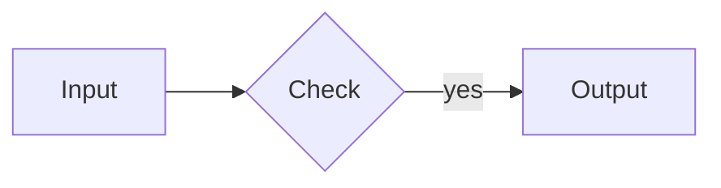

Содержимое сайта хранится в формате Markdown в открытом репозитории [MCSOG-Docs](https://github.com/Minecraft-Server-Opening-Guide/MCSOG-Docs), и любой желающий может предложить правки.

## Каталоги и именование

| Тип | Путь |
| --- | --- |
| Руководства | `docs/zh/tutorials/<category>/<slug>.md`, категории `java` / `bedrock` / `ops` / `faq` |
| Энциклопедия | `docs/zh/wiki/<name>.md` |
| Объявления | Приватный репозиторий `docs/ru-RU/news/<name>.md` (не в публичном) |
| Справка | `docs/zh/help/<name>.md` |

## docslist.json и учебные документы

`docslist.json` управляет только учебными материалами. `nav` — навигация по руководствам в боковой панели (обзор, Java-сервер, Bedrock-сервер, эксплуатация и безопасность, FAQ); `docs` — индекс руководств с категориями `java`, `be`, `ops`, `faq` (`be` соответствует каталогу `bedrock`). `help`, `wiki` и `news` сюда не записываются.

```json
{
  "nav": [
    { "key": "tutorials", "icon": "book-open", "path": "/tutorials", "label": { "zh": "教程总览", "en": "Overview" }, "sub": { "zh": "OVERVIEW", "en": "OVERVIEW" } }
  ],
  "docs": {
    "java": {
      "ru-RU": [
        { "path": "/ru-RU/tutorials/java/example", "title": "Пример руководства", "slug": "example", "cat": "java", "updated": "2026-11-03", "level": 1, "minute": 10, "order": 1 }
      ]
    }
  }
}
```

`path` — внутренний путь руководства, `slug` должен совпадать с именем Markdown-файла. При добавлении отправьте Markdown и запись в нужной категории и языке.

Английские файлы **полностью повторяют структуру путей** китайских: достаточно заменить `zh` на `en`.
`<slug>` записывается строчными латинскими буквами и дефисами и становится последним сегментом URL страницы; имя файла должно совпадать с `slug`.

В начале файла руководства нужен YAML front-matter:

```yaml
---
title: Развёртывание сервера Paper на Linux
slug: linux-paper
cat: java
level: 2
minutes: 15
mc: ["1.21.x", "1.20.4"]
tags: [linux, paper, systemd]
updated: 2026-10-06
draft: false
---
```

| Поле | Значение |
| --- | --- |
| `title` | Заголовок страницы и записи в списке |
| `slug` | Имя файла без `.md`, одновременно сегмент URL |
| `cat` | Каталог категории: `java` / `bedrock` / `ops` / `faq` |
| `level` | Сложность 1–3, выводится как метка |
| `minutes` | Ожидаемое время чтения в минутах |
| `mc` | Подходящие версии Minecraft |
| `tags` | Метки, используются и во внутреннем поиске |
| `updated` | `YYYY-MM-DD`, по нему сортируется список |
| `draft` | При значении `true` страница не публикуется |

## Расширения текста

Рендерер Markdown поддерживает стандартный Markdown, расширения GFM и набор дополнений для текста. Ниже перечислено всё, что доступно, по категориям.

### Основы

| Синтаксис | Результат | Пример |
| --- | --- | --- |
| `# Заголовок` | Уровни 1–6, попадают в оглавление справа | `## Установка` |
| `**жирный**` | Жирный | **жирный** |
| `*курсив*` | Курсив | *курсив* |
| `~~зачёркнутый~~` | Зачёркнутый | ~~зачёркнутый~~ |
| `` `код` `` | Код в строке | `npm install` |
| `[текст](ссылка)` | Ссылка | [Главная](/) |
| `` | Изображение | см. раздел об изображениях |
| `---` | Горизонтальная линия | |
| `| таблица |` | Таблица, вторая строка — разделитель | см. выше |
| ```` ```lang ```` | Блок кода с языком и кнопкой копирования | см. ниже |

### Списки

Дефис, звёздочка и плюс начинают маркированный список и могут вкладываться. Число с точкой или скобкой начинает нумерованный список.

```markdown
- Пункт с дефисом
- Второй пункт
  - Вложенный пункт
    - Третий уровень

* Пункт со звёздочкой
* Второй пункт

+ Пункт с плюсом
+ Второй пункт

1. Первый пункт
2. Второй пункт
   1. Вложенный пункт
3. Третий пункт
```

Список задач GFM: `- [ ]` — не выполнено, `- [x]` или `- [X]` — выполнено:

```markdown
- [ ] Не выполнено
- [x] Выполнено
- [X] Заглавная X тоже работает
```

Как выглядит:

- [ ] Не выполнено
- [x] Выполнено
- [X] Заглавная X тоже работает

### Выделение

Оберните текст в `==...==`, чтобы выделить его жёлтым:

```markdown
Это ==важная часть==, остальное — обычный текст.
```

Как выглядит:

Это ==важная часть==, остальное — обычный текст.

### Размер и выравнивание изображений

Добавьте к адресу изображения `#size=` или `#align=`. Оба параметра можно совмещать.

| Синтаксис | Результат |
| --- | --- |
| `` | Исходный размер, не шире колонки |
| `` | Фиксированно 320×180 пикселей |
| `` | 50% ширины колонки |
| `` | По центру |
| `` | По правому краю |
| `` | По левому краю |
| `` | Оба параметра |

```markdown

```

### Аудио и видео

`` вставляет аудиоплеер, `` — видеоплеер. Для видео после адреса можно указать `.h=высота.w=ширина`.

```markdown


.h=270.w=480
```

### Блоки-заметки

:::note Примечание
Открывается строкой `:::note Заголовок`, закрывается строкой из одних `:::`. Так же работают `:::tip`, `:::warn` и `:::danger`.
:::

```markdown
:::note Примечание
Это блок note.
:::

:::tip Совет
Это блок tip.
:::

:::warn Предупреждение
Это блок warn.
:::

:::danger Опасность
Это блок danger.
:::
```

Можно и через цитату: одна буква после `>` задаёт тип, пробел после буквы допустим.

| Синтаксис | Тип | Цвет |
| --- | --- | --- |
| `> текст` | Обычная цитата | Серый |
| `> i текст` или `>i текст` | Информация | Синий |
| `> d текст` или `>d текст` | Опасность | Красный |
| `> w текст` или `>w текст` | Предупреждение | Оранжевый |
| `> s текст` или `>s текст` | Успех | Зелёный |

> Так выглядит обычная цитата.

> i Это информационная заметка.

> d Это заметка об опасности.

> w Это предупреждение.

> s Это заметка об успехе.

### Шаги

:::step Примечание
Открывается строкой `:::step Заголовок`, закрывается строкой из одних `:::`. Подряд идущие шаги объединяются в нумерованную последовательность.
:::

```markdown
:::step Шаг 1
Скачайте сервер.
:::

:::step Шаг 2
Отредактируйте server.properties.
:::
```

### Формулы

Формула в строке оборачивается в один знак доллара, выключная — в два.

```markdown
$E=mc^2$

$$
\int_{0}^{1} x^{2}\,dx = \frac{1}{3}
$$
```

Доступен весь язык KaTeX, включая матрицы, системы, суммы и интегралы:

$$
\begin{pmatrix} a & b \\ c & d \end{pmatrix}
\begin{pmatrix} x \\ y \end{pmatrix}
=
\begin{pmatrix} ax+by \\ cx+dy \end{pmatrix}
$$

### Блок-схема

Блок `flow` принимает синтаксис flowchart.js:

````markdown
```flow
st=>start: Start
op=>operation: Work
cond=>condition: Pass?
e=>end: Done

st->op->cond
cond(yes)->e
cond(no)->op
```
````

```flow
st=>start: Start
op=>operation: Work
cond=>condition: Pass?
e=>end: Done

st->op->cond
cond(yes)->e
cond(no)->op
```

### Диаграмма последовательности

Блок `seq` принимает синтаксис js-sequence-diagrams: `->` — сплошная линия, `-->` — пунктирная:

````markdown
```seq
Client->Server: request
Server-->Client: response
```
````

```seq
Client->Server: request
Server-->Client: response
```

### Mermaid

Блок `mermaid` принимает синтаксис Mermaid напрямую: блок-схемы, диаграммы последовательностей, классов, состояний и другие:

````markdown

````


### Интеллект-карта

Блок `mindmap` начинается со слова `mindmap`, вложенность задаётся отступами:

````markdown
```mindmap
mindmap
  root((Topic))
    Branch
      Leaf
```
````

```mindmap
mindmap
  root((MCSOG))
    Tutorials
      Java
      Bedrock
    Resources
      Mods
      Plugins
```

### Хронология

Блок `timeline`: по одной записи в строке в формате `дата: текст`:

````markdown
```timeline
2026-09-01: Site launch
2026-11-24: New renderer
```
````

```timeline
2026-09-01: Site launch
2026-11-14: Notifications
2026-11-24: Renderer extended
```

### Графики

Блок `echarts` принимает объект настроек ECharts в формате JSON:

````markdown
```echarts
{
  "xAxis": { "type": "category", "data": ["A", "B", "C"] },
  "yAxis": { "type": "value" },
  "series": [{ "type": "bar", "data": [10, 20, 15] }]
}
```
````

```echarts
{
  "xAxis": { "type": "category", "data": ["A", "B", "C"] },
  "yAxis": { "type": "value" },
  "series": [{ "type": "bar", "data": [10, 20, 15], "itemStyle": { "color": "#8ec91d" } }]
}
```

### HTML-сущности

Поддерживаются стандартные HTML-сущности и выводятся соответствующим символом:

| Entity | Renders | Entity | Renders |
| --- | --- | --- | --- |
| `&copy;` | &copy; | `&reg;` | &reg; |
| `&trade;` | &trade; | `&uml;` | &uml; |
| `&iexcl;` | &iexcl; | `&pound;` | &pound; |
| `&yen;` | &yen; | `&euro;` | &euro; |
| `&plusmn;` | &plusmn; | `&para;` | &para; |
| `&sect;` | &sect; | `&brvbar;` | &brvbar; |
| `&macr;` | &macr; | `&laquo;` | &laquo; |
| `&raquo;` | &raquo; | `&middot;` | &middot; |
| `&sup2;` | &sup2; | `&sup3;` | &sup3; |
| `&frac34;` | &frac34; | `&frac14;` | &frac14; |
| `&times;` | &times; | `&divide;` | &divide; |
| `&ordm;` | &ordm; | `&quot;` | &quot; |
| `&apos;` | &apos; | `&amp;` | &amp; |
| `&lt;` | &lt; | `&gt;` | &gt; |

Работают и числовые формы: `&#169;` даёт &#169;.

Символ `&`, не образующий сущность, экранируется автоматически и не может сломать страницу.

## Стоимость рендеринга

Рендеринг выполняется на сервере. Страница подгружает только те движки (KaTeX, Mermaid, ECharts), которые нужны для использованного синтаксиса; обычная статья не загружает ни одного из них.

## Встраивание HTML

`html.()` вставляет в Markdown настоящий HTML и сохраняет выполнение HTML/JS. Содержимое помещается в Shadow DOM, чтобы его CSS не влиял на вёрстку сайта. Любой другой HTML-тег экранируется и не выполняется.

Полный пример:

```text
html.csp=[example.com,*.example.org].L=640.H=360(<div>...</div>)
```

Параметры:

- `csp=[...]`: список доменов, откуда разрешена загрузка, с шаблонами вида `*.example.com`. С ним блок работает в изолированном iframe с CSP; без него — в Shadow DOM.
- `L` / `H`: ширина / высота в пикселях. Нужны оба; один игнорируется.
- Имена параметров регистронезависимы.
- JS внутри `html.()` выполняется, поэтому встраивайте только доверенное содержимое.

## Расширение HTML-встраивания

`html.()` встраивает сырой HTML в Markdown с сохранением выполнения HTML/JS. По умолчанию содержимое изолируется в Shadow DOM, чтобы его CSS не влиял на макет, отступы и цвета сайта.
Вне `html.()` обычные HTML-теги экранируются как текст и не выполняются.

Полный пример:

```text
html.csp=[example.com,*.example.org].L=640.H=360(<div>...</div>)
```

Параметры:

- `csp=[...]`: список разрешённых доменов, поддерживается шаблон `*.example.com`. При наличии используется изолированный iframe с CSP, иначе Shadow DOM.
- `L` / `H`: ширина / высота в px. Нужны оба параметра; один игнорируется, размер становится автоматическим.
- Имена параметров нечувствительны к регистру.
- JS внутри `html.()` выполняется; встраивайте только доверенный контент.

## Как отправить изменения

:::step Создайте ветку в репозитории
Сделайте форк [MCSOG-Docs](https://github.com/Minecraft-Server-Opening-Guide/MCSOG-Docs) и создайте ветку, добавив файлы согласно каталогам и правилам именования выше.
:::

:::step Отправьте Pull Request
В PR опишите **объём изменений**.
:::

:::note
После слияния в `main` изменения применяются автоматически: синхронизация с основным репозиторием в течение 30 минут, публикация на сайте в течение 2 часов.
:::

Правила написания и цитирования — в разделе [Участие и правила](/help/contribute).
