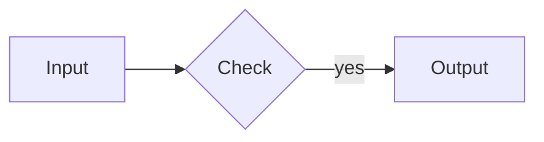

Nội dung của trang này được lưu dưới dạng Markdown, toàn bộ nằm trong kho công khai [MCSOG-Docs](https://github.com/Minecraft-Server-Opening-Guide/MCSOG-Docs), bất kỳ ai cũng có thể gửi chỉnh sửa.

## Thư mục và cách đặt tên

| Loại | Đường dẫn |
| --- | --- |
| Hướng dẫn | `docs/zh/tutorials/<phân loại>/<slug>.md`, phân loại là `java` / `bedrock` / `ops` / `faq` |
| Bách khoa | `docs/zh/wiki/<tên>.md` |
| Thông báo | Kho riêng tư `docs/vi/news/<tên>.md` (không có trong kho công khai) |
| Trợ giúp | `docs/zh/help/<tên>.md` |

## docslist.json và tài liệu hướng dẫn

`docslist.json` chỉ quản lý nội dung hướng dẫn. `nav` là điều hướng hướng dẫn ở thanh bên (tổng quan, máy chủ Java, máy chủ Bedrock, vận hành & bảo mật, FAQ); `docs` là chỉ mục hướng dẫn với bốn danh mục `java`, `be`, `ops`, `faq` (`be` tương ứng thư mục `bedrock`). Không ghi `help`, `wiki`, `news` vào đây.

```json
{
  "nav": [
    { "key": "tutorials", "icon": "book-open", "path": "/tutorials", "label": { "zh": "教程总览", "en": "Overview" }, "sub": { "zh": "OVERVIEW", "en": "OVERVIEW" } }
  ],
  "docs": {
    "java": {
      "vi": [
        { "path": "/vi/tutorials/java/example", "title": "Hướng dẫn mẫu", "slug": "example", "cat": "java", "updated": "2026-11-03", "level": 1, "minute": 10, "order": 1 }
      ]
    }
  }
}
```

`path` là đường dẫn hướng dẫn trong site; `slug` phải khớp tên tệp Markdown. Khi thêm hướng dẫn, gửi tệp Markdown và đăng ký mục dưới đúng danh mục và ngôn ngữ.

Tệp tiếng Anh và tiếng Trung **tương ứng một một về đường dẫn**, chỉ đổi `zh` thành `en`.
`<slug>` dùng chữ thường tiếng Anh và dấu gạch nối, sẽ trở thành đoạn cuối của URL trang; tên tệp và `slug` phải giống nhau.

Đầu tệp hướng dẫn cần có YAML front-matter:

```yaml
---
title: Triển khai máy chủ Paper trên Linux
slug: linux-paper
cat: java
level: 2
minutes: 15
mc: ["1.21.x", "1.20.4"]
tags: [linux, paper, systemd]
updated: 2026-10-06
draft: false
---
```

| Trường | Ý nghĩa |
| --- | --- |
| `title` | Tiêu đề trang và tiêu đề trong danh sách |
| `slug` | Tên tệp bỏ `.md`, đồng thời là một đoạn của URL |
| `cat` | Thư mục phân loại: `java` / `bedrock` / `ops` / `faq` |
| `level` | Độ khó 1–3, hiển thị dưới dạng nhãn |
| `minutes` | Số phút đọc dự kiến |
| `mc` | Phiên bản Minecraft áp dụng |
| `tags` | Nhãn, tìm kiếm trong trang cũng dùng đến |
| `updated` | `YYYY-MM-DD`, danh sách sắp xếp theo trường này |
| `draft` | Đặt là `true` thì trang không lên trực tuyến |

## Mở rộng nội dung

Trình kết xuất Markdown hỗ trợ Markdown chuẩn, các phần mở rộng GFM và một loạt cú pháp mở rộng cho nội dung. Dưới đây liệt kê toàn bộ theo từng nhóm.

### Cú pháp cơ bản

| Cú pháp | Kết quả | Ví dụ |
| --- | --- | --- |
| `# Tiêu đề` | Tiêu đề cấp 1-6, tự động vào mục lục bên phải | `## Cài đặt` |
| `**in đậm**` | In đậm | **in đậm** |
| `*in nghiêng*` | In nghiêng | *in nghiêng* |
| `~~gạch ngang~~` | Gạch ngang | ~~gạch ngang~~ |
| `` `mã` `` | Mã trong dòng | `npm install` |
| `[chữ](liên kết)` | Liên kết | [Trang chủ](/) |
| `` | Hình ảnh | xem mục hình ảnh bên dưới |
| `---` | Đường kẻ ngang | |
| `| bảng |` | Bảng, dòng thứ hai là dòng phân cách | xem bảng trên |
| ```` ```lang ```` | Khối mã có nhãn ngôn ngữ và nút sao chép | xem bên dưới |

### Danh sách

Dấu gạch ngang, dấu sao và dấu cộng đều tạo danh sách không thứ tự và lồng nhau được. Số kèm dấu chấm hoặc dấu ngoặc tạo danh sách có thứ tự.

```markdown
- Mục gạch ngang
- Mục thứ hai
  - Mục lồng nhau
    - Cấp thứ ba

* Mục dấu sao
* Mục thứ hai

+ Mục dấu cộng
+ Mục thứ hai

1. Mục thứ nhất
2. Mục thứ hai
   1. Mục lồng nhau
3. Mục thứ ba
```

Danh sách việc cần làm GFM dùng `- [ ]` cho chưa xong, `- [x]` hoặc `- [X]` cho đã xong:

```markdown
- [ ] Chưa xong
- [x] Đã xong
- [X] Chữ X hoa cũng được
```

Hiển thị:

- [ ] Chưa xong
- [x] Đã xong
- [X] Chữ X hoa cũng được

### Đánh dấu

Bọc văn bản trong `==...==` để tô sáng màu vàng:

```markdown
Đây là ==phần quan trọng==, phần còn lại là văn bản thường.
```

Hiển thị:

Đây là ==phần quan trọng==, phần còn lại là văn bản thường.

### Kích thước và căn lề hình ảnh

Thêm `#size=` hoặc `#align=` vào sau địa chỉ hình ảnh. Có thể dùng cả hai cùng lúc.

| Cú pháp | Kết quả |
| --- | --- |
| `` | Kích thước gốc, không vượt quá chiều rộng cột |
| `` | Cố định 320×180 pixel |
| `` | 50% chiều rộng cột |
| `` | Căn giữa |
| `` | Căn phải |
| `` | Căn trái |
| `` | Kết hợp cả hai |

```markdown

```

### Âm thanh và video

`` nhúng trình phát âm thanh, `` nhúng trình phát video. Video có thể thêm `.h=cao.w=rộng` sau địa chỉ để đặt kích thước.

```markdown


.h=270.w=480
```

### Khối ghi chú

:::note Ghi chú
Mở bằng `:::note Tiêu đề` và đóng bằng một dòng chỉ có `:::`. `:::tip`, `:::warn` và `:::danger` dùng tương tự.
:::

```markdown
:::note Ghi chú
Đây là khối note.
:::

:::tip Mẹo
Đây là khối tip.
:::

:::warn Cảnh báo
Đây là khối warn.
:::

:::danger Nguy hiểm
Đây là khối danger.
:::
```

Cũng có thể dùng cú pháp trích dẫn: một chữ cái sau `>` chọn loại, có thể có dấu cách sau chữ cái.

| Cú pháp | Loại | Màu |
| --- | --- | --- |
| `> văn bản` | Trích dẫn thường | Xám |
| `> i văn bản` hoặc `>i văn bản` | Thông tin | Xanh dương |
| `> d văn bản` hoặc `>d văn bản` | Nguy hiểm | Đỏ |
| `> w văn bản` hoặc `>w văn bản` | Cảnh báo | Cam |
| `> s văn bản` hoặc `>s văn bản` | Thành công | Xanh lá |

> Đây là trích dẫn thường.

> i Đây là khối thông tin.

> d Đây là khối nguy hiểm.

> w Đây là khối cảnh báo.

> s Đây là khối thành công.

### Các bước

:::step Ghi chú
Mở bằng `:::step Tiêu đề` và đóng bằng một dòng chỉ có `:::`. Các khối bước liền nhau sẽ gộp thành chuỗi bước có đánh số.
:::

```markdown
:::step Bước một
Tải máy chủ về.
:::

:::step Bước hai
Sửa tệp server.properties.
:::
```

### Công thức toán

Công thức trong dòng đặt giữa hai dấu đô-la đơn, công thức riêng dòng đặt giữa hai cặp dấu đô-la.

```markdown
$E=mc^2$

$$
\int_{0}^{1} x^{2}\,dx = \frac{1}{3}
$$
```

Hỗ trợ đầy đủ cú pháp KaTeX, gồm ma trận, hệ phương trình, tổng và tích phân:

$$
\begin{pmatrix} a & b \\ c & d \end{pmatrix}
\begin{pmatrix} x \\ y \end{pmatrix}
=
\begin{pmatrix} ax+by \\ cx+dy \end{pmatrix}
$$

### Lưu đồ

Khối `flow` nhận cú pháp flowchart.js:

````markdown
```flow
st=>start: Start
op=>operation: Work
cond=>condition: Pass?
e=>end: Done

st->op->cond
cond(yes)->e
cond(no)->op
```
````

```flow
st=>start: Start
op=>operation: Work
cond=>condition: Pass?
e=>end: Done

st->op->cond
cond(yes)->e
cond(no)->op
```

### Biểu đồ tuần tự

Khối `seq` nhận cú pháp js-sequence-diagrams: `->` là nét liền, `-->` là nét đứt:

````markdown
```seq
Client->Server: request
Server-->Client: response
```
````

```seq
Client->Server: request
Server-->Client: response
```

### Mermaid

Khối `mermaid` nhận trực tiếp cú pháp Mermaid: lưu đồ, biểu đồ tuần tự, biểu đồ lớp, biểu đồ trạng thái và nhiều loại khác:

````markdown

````


### Sơ đồ tư duy

Dùng khối `mindmap`, dòng đầu ghi `mindmap`, thụt đầu dòng thể hiện cấp bậc:

````markdown
```mindmap
mindmap
  root((Topic))
    Branch
      Leaf
```
````

```mindmap
mindmap
  root((MCSOG))
    Tutorials
      Java
      Bedrock
    Resources
      Mods
      Plugins
```

### Dòng thời gian

Dùng khối `timeline`, mỗi dòng một mục theo dạng `ngày: nội dung`:

````markdown
```timeline
2026-09-01: Site launch
2026-11-24: New renderer
```
````

```timeline
2026-09-01: Site launch
2026-11-14: Notifications
2026-11-24: Renderer extended
```

### Biểu đồ số liệu

Khối `echarts` nhận đối tượng cấu hình ECharts dạng JSON:

````markdown
```echarts
{
  "xAxis": { "type": "category", "data": ["A", "B", "C"] },
  "yAxis": { "type": "value" },
  "series": [{ "type": "bar", "data": [10, 20, 15] }]
}
```
````

```echarts
{
  "xAxis": { "type": "category", "data": ["A", "B", "C"] },
  "yAxis": { "type": "value" },
  "series": [{ "type": "bar", "data": [10, 20, 15], "itemStyle": { "color": "#8ec91d" } }]
}
```

### Thực thể HTML

Hỗ trợ thực thể HTML chuẩn và hiển thị đúng ký tự tương ứng:

| Entity | Renders | Entity | Renders |
| --- | --- | --- | --- |
| `&copy;` | &copy; | `&reg;` | &reg; |
| `&trade;` | &trade; | `&uml;` | &uml; |
| `&iexcl;` | &iexcl; | `&pound;` | &pound; |
| `&yen;` | &yen; | `&euro;` | &euro; |
| `&plusmn;` | &plusmn; | `&para;` | &para; |
| `&sect;` | &sect; | `&brvbar;` | &brvbar; |
| `&macr;` | &macr; | `&laquo;` | &laquo; |
| `&raquo;` | &raquo; | `&middot;` | &middot; |
| `&sup2;` | &sup2; | `&sup3;` | &sup3; |
| `&frac34;` | &frac34; | `&frac14;` | &frac14; |
| `&times;` | &times; | `&divide;` | &divide; |
| `&ordm;` | &ordm; | `&quot;` | &quot; |
| `&apos;` | &apos; | `&amp;` | &amp; |
| `&lt;` | &lt; | `&gt;` | &gt; |

Cũng dùng được dạng số: `&#169;` hiển thị &#169;.

Dấu `&` không tạo thành thực thể sẽ được tự động thoát, nên không thể làm hỏng trang.

## Chi phí kết xuất

Việc kết xuất diễn ra trên máy chủ. Trang chỉ tải những thư viện cần thiết (KaTeX, Mermaid, ECharts) theo cú pháp thực sự dùng; bài viết thường không tải thư viện bên thứ ba nào.

## Nhúng HTML

`html.()` nhúng HTML thô vào Markdown và giữ khả năng thực thi HTML/JS. Nội dung được đặt trong Shadow DOM để CSS bên trong không ảnh hưởng bố cục trang. Mọi thẻ HTML khác đều bị thoát thành văn bản và không thực thi.

Ví dụ đầy đủ:

```text
html.csp=[example.com,*.example.org].L=640.H=360(<div>...</div>)
```

Tham số:

- `csp=[...]`: danh sách tên miền được phép tải, hỗ trợ ký tự đại diện `*.example.com`. Có tham số này thì khối chạy trong iframe cách ly kèm CSP; không có thì dùng Shadow DOM.
- `L` / `H`: chiều rộng / chiều cao tính bằng pixel. Phải có cả hai; chỉ một cái sẽ bị bỏ qua.
- Tên tham số không phân biệt chữ hoa chữ thường.
- JS trong `html.()` có thực thi, nên chỉ nhúng nội dung bạn tin cậy.

## Tiện ích nhúng HTML

`html.()` cho phép nhúng HTML thô trong Markdown và vẫn giữ khả năng thực thi HTML/JS. Nội dung mặc định được cô lập trong Shadow DOM để CSS bên trong không ảnh hưởng đến bố cục, khoảng cách hay màu sắc của trang.
Ngoài `html.()`, các thẻ HTML thường sẽ được thoát thành văn bản và không thực thi.

Ví dụ đầy đủ:

```text
html.csp=[example.com,*.example.org].L=640.H=360(<div>...</div>)
```

Tham số:

- `csp=[...]`: danh sách tên miền được phép, hỗ trợ ký tự đại diện `*.example.com`. Khi có, nội dung chạy trong iframe cô lập kèm CSP; nếu không có, dùng Shadow DOM.
- `L` / `H`: chiều rộng / chiều cao tính bằng px. Phải có cả hai; chỉ một tham số sẽ bị bỏ qua và kích thước tự động.
- Tên tham số không phân biệt chữ hoa chữ thường.
- JS bên trong `html.()` sẽ thực thi; chỉ nhúng nội dung đáng tin cậy.

## Cách gửi

:::step Tạo nhánh trong kho
Fork [MCSOG-Docs](https://github.com/Minecraft-Server-Opening-Guide/MCSOG-Docs) rồi tạo nhánh mới, thêm tệp theo thư mục và cách đặt tên ở trên.
:::

:::step Gửi Pull Request
Nêu rõ **phạm vi thay đổi** trong PR.
:::

:::note
Sau khi merge vào `main` sẽ tự động có hiệu lực: trong 30 phút đồng bộ vào kho chính, trong 2 giờ lên trực tuyến.
:::

Quy định viết và trích dẫn xem ở [Đóng góp và quy định](/help/contribute).
