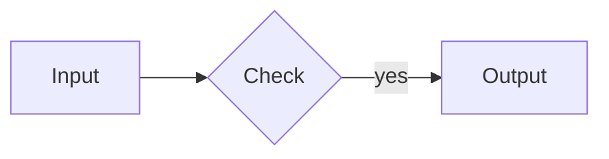

本站內容以 Markdown 形式儲存，全部放在公開倉庫 [MCSOG-Docs](https://github.com/Minecraft-Server-Opening-Guide/MCSOG-Docs) 裡，任何人都可以提交修改。

## 目錄與命名

| 類型 | 路徑 |
| --- | --- |
| 教學 | `docs/zh/tutorials/<category>/<slug>.md`，分類為 `java` / `bedrock` / `ops` / `faq` |
| 百科 | `docs/zh/wiki/<name>.md` |
| 公告 | 私有仓 `docs/zh/news/<name>.md`（公开仓不维护） |
| 幫助 | `docs/zh/help/<name>.md` |

## docslist.json 與教學文件

`docslist.json` 只管理開服教學：`nav` 是側欄教學導覽項目（教學總覽、Java 版開服、基岩版開服、維運與安全、常見問題），`docs` 是教學文件索引，分類固定為 `java`、`be`、`ops`、`faq`（`be` 對應磁碟上的 `bedrock` 目錄）。`help`、`wiki`、`news` 不寫入此檔。

```json
{
  "nav": [
    { "key": "tutorials", "icon": "book-open", "path": "/tutorials", "label": { "zh": "教學總覽", "en": "Overview" }, "sub": { "zh": "OVERVIEW", "en": "OVERVIEW" } }
  ],
  "docs": {
    "java": {
      "zh": [
        { "path": "/zh/tutorials/java/example", "title": "範例教學", "slug": "example", "cat": "java", "updated": "2026-11-03", "level": 1, "minute": 10, "order": 1 }
      ]
    }
  }
}
```

`path` 是教學頁面的站內路徑；`slug` 必須與 Markdown 檔名一致。新增教學時提交 Markdown 檔案，並在對應分類和語言下登記條目。

英文檔案與中文**路徑一一對應**，只把 `zh` 換成 `en`。
`<slug>` 用小寫英文與連字元，會成為頁面 URL 的最後一段；檔名與 `slug` 必須一致。

教學檔案開頭需要 YAML front-matter：

```yaml
---
title: 在 Linux 上部署 Paper 服務端
slug: linux-paper
cat: java
level: 2
minutes: 15
mc: ["1.21.x", "1.20.4"]
tags: [linux, paper, systemd]
updated: 2026-10-06
draft: false
---
```

| 欄位 | 含義 |
| --- | --- |
| `title` | 頁面與列表標題 |
| `slug` | 檔名去掉 `.md`，同時是 URL 的一段 |
| `cat` | 分類目錄：`java` / `bedrock` / `ops` / `faq` |
| `level` | 難度 1–3，顯示為標籤 |
| `minutes` | 預計閱讀分鐘數 |
| `mc` | 適用的 Minecraft 版本 |
| `tags` | 標籤，站內搜尋也會用到 |
| `updated` | `YYYY-MM-DD`，列表按它排序 |
| `draft` | 設為 `true` 時該頁不上線 |

## 正文擴充

本站的 Markdown 渲染器支援標準 Markdown、GFM 擴充，以及一批正文增強語法。以下按類別列出全部可用寫法。

### 基礎語法

| 寫法 | 效果 | 範例 |
| --- | --- | --- |
| `# 標題` | 一至六級標題，自動產生右側目錄 | `## 安裝` |
| `**粗體**` | 粗體 | **粗體** |
| `*斜體*` | 斜體 | *斜體* |
| `~~刪除線~~` | 刪除線 | ~~刪除線~~ |
| `` `程式碼` `` | 行內程式碼 | `npm install` |
| `[文字](連結)` | 超連結 | [首頁](/) |
| `` | 圖片 | 見下方圖片章節 |
| `---` | 分隔線 | |
| `| 表格 |` | 表格，第二列為分隔列 | 見上表 |
| ```` ```lang ```` | 帶語言標註的程式碼區塊，支援一鍵複製 | 見下方 |

### 列表

減號、星號、加號都可用於無序列表，支援多層巢狀；數字加點或右括號是有序列表。

```markdown
- 減號列表項
- 第二項
  - 巢狀項
    - 三層巢狀

* 星號列表項
* 第二項

+ 加號列表項
+ 第二項

1. 有序第一項
2. 有序第二項
   1. 巢狀有序項
3. 有序第三項
```

GFM 任務列表用 `- [ ]` 表示未完成、`- [x]` 或 `- [X]` 表示已完成：

```markdown
- [ ] 未完成的任務
- [x] 已完成的任務
- [X] 大寫勾選同樣有效
```

渲染效果：

- [ ] 未完成的任務
- [x] 已完成的任務
- [X] 大寫勾選同樣有效

### 高亮標記

用 `==文字==` 標記重點，渲染為黃色高亮：

```markdown
這是 ==需要強調的關鍵內容==，其餘為一般文字。
```

渲染效果：

這是 ==需要強調的關鍵內容==，其餘為一般文字。

### 圖片尺寸與對齊

在圖片位址後追加 `#size=` 或 `#align=` 控制顯示，兩個參數可以組合使用。

| 寫法 | 效果 |
| --- | --- |
| `` | 原始尺寸，寬度不超過正文 |
| `` | 固定 320×180 像素 |
| `` | 正文寬度的 50% |
| `` | 置中 |
| `` | 靠右 |
| `` | 靠左 |
| `` | 組合使用 |

```markdown

```

### 音訊與影片

用 `` 嵌入音訊播放器，`` 嵌入影片播放器。影片可在位址後接 `.h=高度.w=寬度` 指定尺寸。

```markdown


.h=270.w=480
```

### 提示區塊

:::note 注意
用 `:::note 標題` 開始、單獨一行 `:::` 結束。同類還有 `:::tip`、`:::warn`、`:::danger`。
:::

```markdown
:::note 注意
這是 note 提示區塊。
:::

:::tip 提示
這是 tip 提示區塊。
:::

:::warn 警告
這是 warn 警告區塊。
:::

:::danger 危險
這是 danger 危險區塊。
:::
```

也支援引用語法：`>` 後跟單個字母表示類型，字母後可加空格。

| 寫法 | 類型 | 顏色 |
| --- | --- | --- |
| `> 文字` | 一般引用 | 灰色 |
| `> i 文字` 或 `>i 文字` | 資訊提示 | 藍色 |
| `> d 文字` 或 `>d 文字` | 危險提示 | 紅色 |
| `> w 文字` 或 `>w 文字` | 警告提示 | 橘色 |
| `> s 文字` 或 `>s 文字` | 成功提示 | 綠色 |

> 這是預設樣式的一般引用。

> i 這是資訊提示區塊。

> d 這是危險提示區塊。

> w 這是警告提示區塊。

> s 這是成功提示區塊。

### 步驟條

:::step 注意
用 `:::step 標題` 開始、單獨一行 `:::` 結束。連續多個步驟區塊會自動合併成帶序號的步驟條。
:::

```markdown
:::step 第一步
下載伺服端。
:::

:::step 第二步
設定 server.properties。
:::
```

### 數學公式

行內公式用單個美元符號包住，行間公式用兩個美元符號包住。

```markdown
$E=mc^2$

$$
\int_{0}^{1} x^{2}\,dx = \frac{1}{3}
$$
```

支援 KaTeX 全部語法，包含矩陣、分段函式、求和積分等：

$$
\begin{pmatrix} a & b \\ c & d \end{pmatrix}
\begin{pmatrix} x \\ y \end{pmatrix}
=
\begin{pmatrix} ax+by \\ cx+dy \end{pmatrix}
$$

### 流程圖

用 `flow` 程式碼區塊寫 flowchart.js 語法：

````markdown
```flow
st=>start: Start
op=>operation: Work
cond=>condition: Pass?
e=>end: Done

st->op->cond
cond(yes)->e
cond(no)->op
```
````

```flow
st=>start: Start
op=>operation: Work
cond=>condition: Pass?
e=>end: Done

st->op->cond
cond(yes)->e
cond(no)->op
```

### 序列圖

用 `seq` 程式碼區塊寫 js-sequence-diagrams 語法，`->` 實線、`-->` 虛線：

````markdown
```seq
Client->Server: request
Server-->Client: response
```
````

```seq
Client->Server: request
Server-->Client: response
```

### Mermaid 圖表

用 `mermaid` 程式碼區塊直接寫 Mermaid 語法，支援流程圖、時序圖、類別圖、狀態圖等：

````markdown

````


### 心智圖

用 `mindmap` 程式碼區塊，第一行寫 `mindmap`，縮排表示層級：

````markdown
```mindmap
mindmap
  root((Topic))
    Branch
      Leaf
```
````

```mindmap
mindmap
  root((MCSOG))
    Tutorials
      Java
      Bedrock
    Resources
      Mods
      Plugins
```

### 時間軸

用 `timeline` 程式碼區塊，每行一條，`日期: 內容` 格式：

````markdown
```timeline
2026-09-01: Site launch
2026-11-24: New renderer
```
````

```timeline
2026-09-01: Site launch
2026-11-14: Notifications
2026-11-24: Renderer extended
```

### 圖表

用 `echarts` 程式碼區塊寫 ECharts 設定 JSON：

````markdown
```echarts
{
  "xAxis": { "type": "category", "data": ["A", "B", "C"] },
  "yAxis": { "type": "value" },
  "series": [{ "type": "bar", "data": [10, 20, 15] }]
}
```
````

```echarts
{
  "xAxis": { "type": "category", "data": ["A", "B", "C"] },
  "yAxis": { "type": "value" },
  "series": [{ "type": "bar", "data": [10, 20, 15], "itemStyle": { "color": "#8ec91d" } }]
}
```

### HTML 實體符號

支援標準 HTML 實體寫法，會用對應符號顯示：

| Entity | Renders | Entity | Renders |
| --- | --- | --- | --- |
| `&copy;` | &copy; | `&reg;` | &reg; |
| `&trade;` | &trade; | `&uml;` | &uml; |
| `&iexcl;` | &iexcl; | `&pound;` | &pound; |
| `&yen;` | &yen; | `&euro;` | &euro; |
| `&plusmn;` | &plusmn; | `&para;` | &para; |
| `&sect;` | &sect; | `&brvbar;` | &brvbar; |
| `&macr;` | &macr; | `&laquo;` | &laquo; |
| `&raquo;` | &raquo; | `&middot;` | &middot; |
| `&sup2;` | &sup2; | `&sup3;` | &sup3; |
| `&frac34;` | &frac34; | `&frac14;` | &frac14; |
| `&times;` | &times; | `&divide;` | &divide; |
| `&ordm;` | &ordm; | `&quot;` | &quot; |
| `&apos;` | &apos; | `&amp;` | &amp; |
| `&lt;` | &lt; | `&gt;` | &gt; |

也可以直接寫十進位或十六進位數字，例如 `&#169;` 顯示為 &#169;。

沒有構成實體的 `&` 會被自動轉義，不會破壞頁面。

## 渲染效能說明

渲染在伺服端完成。頁面會依實際使用的語法按需載入對應渲染庫（KaTeX、Mermaid、ECharts），一般文章不載入任何第三方函式庫，因此正文載入不受影響。

## HTML 嵌入擴充

`html.()` 用於在 Markdown 中嵌入原始 HTML，並保留 HTML/JS 執行能力。內容預設放入 Shadow DOM，避免內部 CSS 影響網站排版。除 `html.()` 外，一般 HTML 標籤會被轉義成文字，不會執行。

完整範例：

```text
html.csp=[example.com,*.example.org].L=640.H=360(<div>...</div>)
```

參數：

- `csp=[...]`：允許載入的網域清單，支援 `*.example.com` 萬用字元；填寫後使用帶 CSP 的隔離 iframe，不填則使用 Shadow DOM。
- `L` / `H`：寬度 / 高度，單位 px；必須同時出現，只填一個視為無效。
- 參數名不區分大小寫。
- `html.()` 內的 JS 會執行；只應嵌入可信內容。

## HTML 嵌入擴充

`html.()` 用於在 Markdown 中嵌入原始 HTML，並保留 HTML/JS 執行能力。內容預設放入 Shadow DOM，避免內部 CSS 影響網站排版、佈局和顏色。

完整範例：

```text
html.csp=[example.com,*.example.org].L=640.H=360(<div>...</div>)
```

參數：

- `csp=[...]`：允許載入的網域清單，支援 `*.example.com` 萬用字元；填寫後會使用帶 CSP 的隔離 iframe，不填則使用 Shadow DOM。
- `L` / `H`：寬度 / 高度，單位 px；必須同時出現，只填一個視為無效，自動適應。
- 參數名稱不分大小寫。
- `html.()` 內的 JS 會執行；只應嵌入可信內容。

## 提交方式

:::step 在倉庫新建分支
Fork [MCSOG-Docs](https://github.com/Minecraft-Server-Opening-Guide/MCSOG-Docs) 後新建一個分支，按上面的目錄與命名新增檔案。
:::

:::step 提交 Pull Request
在 PR 裡說明**改動範圍**。
:::

:::note
合併進 `main` 後自動生效：30 分鐘內同步進主倉庫，2 小時內上線。
:::

寫作與引用規範見[貢獻與規範](/help/contribute)。

除 `html.()` 外，普通 HTML 標籤會被轉義成文字，不會執行。
