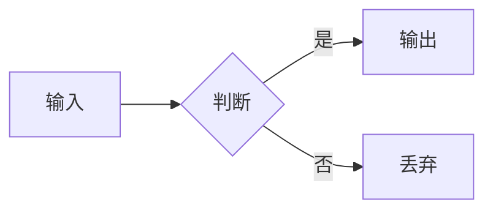

本站内容以 Markdown 形式存储，全部放在公开仓库 [MCSOG-Docs](https://github.com/Minecraft-Server-Opening-Guide/MCSOG-Docs) 里，任何人都可以提交修改。

## 目录与命名

| 类型 | 路径 |
| --- | --- |
| 教程 | `docs/zh/tutorials/<category>/<slug>.md`，分类为 `java` / `bedrock` / `ops` / `faq` |
| 百科 | `docs/zh/wiki/<name>.md` |
| 公告 | 私有仓 `docs/zh/news/<name>.md`（公开仓不维护） |
| 帮助 | `docs/zh/help/<name>.md` |

## docslist.json 与教程文档

`docslist.json` 只管理开服教程：`nav` 是侧栏教程导航项（教程总览、Java 版开服、基岩版开服、运维与安全、常见问题），`docs` 是教程文档索引，分类固定为 `java`、`be`、`ops`、`faq`（`be` 对应磁盘上的 `bedrock` 目录）。`help`、`wiki`、`news` 不写入此文件。

```json
{
  "nav": [
    { "key": "tutorials", "icon": "book-open", "path": "/tutorials", "label": { "zh": "教程总览", "en": "Overview" }, "sub": { "zh": "OVERVIEW", "en": "OVERVIEW" } }
  ],
  "docs": {
    "java": {
      "zh": [
        { "path": "/zh/tutorials/java/example", "title": "示例教程", "slug": "example", "cat": "java", "updated": "2026-11-03", "level": 1, "minute": 10, "order": 1 }
      ]
    }
  }
}
```

`path` 是教程页面的站内路径；`slug` 必须与 Markdown 文件名一致。新增教程时提交 Markdown 文件，并在对应分类和语言下登记条目。

英文文件与中文**路径一一对应**，只把 `zh` 换成 `en`。
`<slug>` 用小写英文与连字符，会成为页面 URL 的最后一段；文件名与 `slug` 必须一致。

教程文件开头需要 YAML front-matter：

```yaml
---
title: 在 Linux 上部署 Paper 服务端
slug: linux-paper
cat: java
level: 2
minutes: 15
mc: ["1.21.x", "1.20.4"]
tags: [linux, paper, systemd]
updated: 2026-10-06
draft: false
---
```

| 字段 | 含义 |
| --- | --- |
| `title` | 页面与列表标题 |
| `slug` | 文件名去掉 `.md`，同时是 URL 的一段 |
| `cat` | 分类目录：`java` / `bedrock` / `ops` / `faq` |
| `level` | 难度 1–3，显示为标签 |
| `minutes` | 预计阅读分钟数 |
| `mc` | 适用的 Minecraft 版本 |
| `tags` | 标签，站内搜索也会用到 |
| `updated` | `YYYY-MM-DD`，列表按它排序 |
| `draft` | 设为 `true` 时该页不上线 |

## 正文扩展

本站的 Markdown 渲染器支持标准 Markdown、GFM 扩展，以及一批正文增强语法。下面按类别列出全部可用写法。

### 基础语法

| 写法 | 效果 | 示例 |
| --- | --- | --- |
| `# 标题` | 一至六级标题，自动生成右侧目录 | `## 安装` |
| `**粗体**` | 粗体 | **粗体** |
| `*斜体*` | 斜体 | *斜体* |
| `~~删除线~~` | 删除线 | ~~删除线~~ |
| `` `代码` `` | 行内代码 | `npm install` |
| `[文字](链接)` | 超链接 | [首页](/) |
| `` | 图片 | 见下方图片章节 |
| `---` | 分隔线 | |
| `\| 表格 \|` | 表格，第二行为分隔行 | 见上表 |
| ```` ```lang ```` | 带语言标注的代码块，支持一键复制 | 见下方 |

### 列表

减号、星号、加号都可用于无序列表，支持多级嵌套；数字加点或右括号是有序列表。

```markdown
- 减号列表项
- 第二项
  - 嵌套项
    - 三级嵌套

* 星号列表项
* 第二项

+ 加号列表项
+ 第二项

1. 有序第一项
2. 有序第二项
   1. 嵌套有序项
3. 有序第三项
```

GFM 任务列表用 `- [ ]` 表示未完成、`- [x]` 或 `- [X]` 表示已完成：

```markdown
- [ ] 未完成的任务
- [x] 已完成的任务
- [X] 大写勾选同样有效
```

### 高亮标记

用 `==文字==` 标记重点，渲染为黄色高亮：

```markdown
这是 ==需要强调的关键内容==。
```

### 图片尺寸与对齐

在图片地址后追加 `#size=` 或 `#align=` 控制显示，两个参数可以组合使用。

| 写法 | 效果 |
| --- | --- |
| `` | 原始尺寸，宽度不超过正文 |
| `` | 固定 320×180 像素 |
| `` | 正文宽度的 50% |
| `` | 居中 |
| `` | 靠右 |
| `` | 靠左 |
| `` | 组合使用 |

```markdown

```

### 音频与视频

用 `` 嵌入音频播放器，`` 嵌入视频播放器。视频可在地址后接 `.h=高度.w=宽度` 指定尺寸。

```markdown


.h=270.w=480
```

### 提示块

:::note 标题块
用 `:::note 标题` 开始、单独一行 `:::` 结束。同类还有 `:::tip`、`:::warn`、`:::danger`。
:::

```markdown
:::note 注意
这是 note 提示块。
:::

:::tip 提示
这是 tip 提示块。
:::

:::warn 警告
这是 warn 警告块。
:::

:::danger 危险
这是 danger 危险块。
:::
```

也支持用引用语法快速写提示块，`>` 后跟单个字母表示类型，字母后可加空格：

| 写法 | 类型 | 颜色 |
| --- | --- | --- |
| `> 文字` | 普通引用 | 灰色 |
| `> i 文字` 或 `>i 文字` | 信息提示 | 蓝色 |
| `> d 文字` 或 `>d 文字` | 危险提示 | 红色 |
| `> w 文字` 或 `>w 文字` | 警告提示 | 橙色 |
| `> s 文字` 或 `>s 文字` | 成功提示 | 绿色 |

> 这是默认样式的普通引用。

> i 这是信息提示块。

> d 这是危险提示块。

> w 这是警告提示块。

> s 这是成功提示块。

### 步骤条

:::step 步骤块
用 `:::step 标题` 开始、单独一行 `:::` 结束。连续多个步骤块会自动合并成带序号的步骤条。
:::

```markdown
:::step 第一步
下载服务端。
:::

:::step 第二步
配置 server.properties。
:::
```

### 数学公式

行内公式用单个美元符号包裹，行间公式用两个美元符号包裹。

```markdown
行内公式：质能方程 $E=mc^2$。

行间公式：

$$
\int_{0}^{1} x^{2}\,dx = \frac{1}{3}
$$
```

支持 KaTeX 的全部语法，包括矩阵、分段函数、求和积分等：

$$
\begin{pmatrix} a & b \\ c & d \end{pmatrix}
\begin{pmatrix} x \\ y \end{pmatrix}
=
\begin{pmatrix} ax+by \\ cx+dy \end{pmatrix}
$$

### 流程图

用 `flow` 代码块写 flowchart.js 语法：

````markdown
```flow
st=>start: 开始
op=>operation: 处理数据
cond=>condition: 是否通过?
e=>end: 结束

st->op->cond
cond(yes)->e
cond(no)->op
```
````

```flow
st=>start: 开始
op=>operation: 处理数据
cond=>condition: 是否通过?
e=>end: 结束

st->op->cond
cond(yes)->e
cond(no)->op
```

### 序列图

用 `seq` 代码块写 js-sequence-diagrams 语法，`->` 实线、`-->` 虚线：

````markdown
```seq
客户端->服务端: 请求数据
服务端-->客户端: 返回结果
```
````

```seq
客户端->服务端: 请求数据
服务端-->客户端: 返回结果
```

### Mermaid 图表

用 `mermaid` 代码块直接写 Mermaid 语法，支持流程图、时序图、类图、状态图等：

````markdown

````


### 思维导图

用 `mindmap` 代码块，第一行写 `mindmap`，缩进表示层级：

````markdown
```mindmap
mindmap
  root((中心主题))
    分支一
      子项
    分支二
      子项
```
````

```mindmap
mindmap
  root((MCSOG))
    教程
      开服
      运维
    资源
      模组
      插件
```

### 时间线

用 `timeline` 代码块，每行一条，`日期: 内容` 格式：

````markdown
```timeline
2026-09-01: 站点上线
2026-11-24: 新增渲染器
```
````

```timeline
2026-09-01: 站点上线
2026-11-14: 通知系统上线
2026-11-24: 渲染器扩展
```

### 图表

用 `echarts` 代码块写 ECharts 配置 JSON：

````markdown
```echarts
{
  "xAxis": { "type": "category", "data": ["A", "B", "C"] },
  "yAxis": { "type": "value" },
  "series": [{ "type": "bar", "data": [10, 20, 15] }]
}
```
````

```echarts
{
  "xAxis": { "type": "category", "data": ["一月", "二月", "三月"] },
  "yAxis": { "type": "value" },
  "series": [{ "type": "bar", "data": [120, 200, 150], "itemStyle": { "color": "#8ec91d" } }]
}
```

### HTML 实体符号

支持标准 HTML 实体写法，会用对应符号显示：

| 实体 | 显示 | 实体 | 显示 |
| --- | --- | --- | --- |
| `&copy;` | &copy; | `&reg;` | &reg; |
| `&trade;` | &trade; | `&uml;` | &uml; |
| `&iexcl;` | &iexcl; | `&pound;` | &pound; |
| `&yen;` | &yen; | `&euro;` | &euro; |
| `&plusmn;` | &plusmn; | `&para;` | &para; |
| `&sect;` | &sect; | `&brvbar;` | &brvbar; |
| `&macr;` | &macr; | `&laquo;` | &laquo; |
| `&raquo;` | &raquo; | `&middot;` | &middot; |
| `&sup2;` | &sup2; | `&sup3;` | &sup3; |
| `&frac34;` | &frac34; | `&frac14;` | &frac14; |
| `&times;` | &times; | `&divide;` | &divide; |
| `&ordm;` | &ordm; | `&quot;` | &quot; |
| `&apos;` | &apos; | `&amp;` | &amp; |
| `&lt;` | &lt; | `&gt;` | &gt; |

也可以直接写十进制或十六进制数字，例如 `&#169;` 显示为 &#169;，`&#xA9;` 显示为 &#xA9;。

没有构成实体的 `&` 会被自动转义，不会破坏页面。

## 渲染性能说明

渲染在服务端完成，一次解析后缓存在浏览器。带数学公式、图表或思维导图的页面才会按需加载对应的渲染库（KaTeX、Mermaid、ECharts），普通文章不加载任何第三方库，因此正文页面的加载不受影响。

## HTML 嵌入扩展

`html.()` 用于在 Markdown 中嵌入原始 HTML，并保留 HTML/JS 执行能力。内容默认放入 Shadow DOM，避免内部 CSS 影响网站排版、布局和颜色。
除 `html.()` 外，普通 HTML 标签会被转义成文本，不会执行。

完整示例：

```text
html.csp=[example.com,*.example.org].L=640.H=360(<div>...</div>)
```

参数：

- `csp=[...]`：允许加载的域名列表，支持 `*.example.com` 通配符；填写后会使用带 CSP 的隔离 iframe，不填则使用 Shadow DOM。
- `L` / `H`：宽度 / 高度，单位 px；必须同时出现，只填一个视为无效，自动适应。
- 参数名不区分大小写。
- `html.()` 内的 JS 会执行；只应嵌入可信内容。

## 提交方式

:::step 在仓库新建分支
Fork [MCSOG-Docs](https://github.com/Minecraft-Server-Opening-Guide/MCSOG-Docs) 后新建一个分支，按上面的目录与命名添加文件。
:::

:::step 提交 Pull Request
在 PR 里说明**改动范围**。
:::

:::note
合并进 `main` 后自动生效：30 分钟内同步进主仓库，2 小时内上线。
:::

写作与引用规范见[贡献与规范](/help/contribute)。
